# Documento de replicación – Cerámicas Vale

Cómo armar paso a paso las soluciones de BI y Big Data de Cerámicas Vale. **Guía para principiantes: no necesitas saber programar.**

| Dato | Detalle |
| --- | --- |
| Curso | Base de Datos Avanzadas y Big Data · NRC 26055 · UPN · 2026-2 |
| Equipo | Elescano Medina, Bruno Martin Kalen · Huarancca Cachique, Sebastian Victor · Huasupoma Rodas, Jimi Roger · Rojas Condorchoa, Diego Javier |
| Repositorio | github.com/brvnomk/BIG-DATA |

# Antes de empezar

Este documento te lleva **de la mano**, paso a paso, para armar en tu computadora las dos soluciones del proyecto: la de **BI** (SQL Server y Power BI) y la de **Big Data** (Databricks). No necesitas saber programar: solo abrir archivos, presionar botones y comparar lo que ves con las capturas.

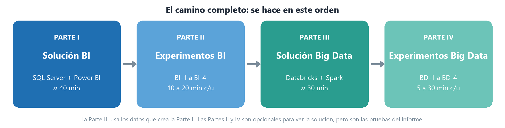
*El camino completo. Cada parte usa lo que dejó lista la anterior.*

## Cómo leer este documento

| Si ves… | Significa… |
| --- | --- |
| Pasos numerados 1, 2, 3… | Hazlos en ese orden, sin saltarte ninguno |
| Un recuadro rojo con un número en una captura | Ahí es donde tienes que mirar o hacer clic. El número coincide con el paso |
| ✅ ¿Salió bien? | Lo que debes ver en pantalla si todo funcionó. Si no lo ves, no sigas: revisa la sección de problemas |
| 💡 Consejo | Un dato que te ahorra tiempo |
| ⚠️ Ojo | Un error típico que conviene evitar |
| Texto `así` | Un nombre exacto (de archivo, carpeta o tabla). Escríbelo igual, con mayúsculas y guiones |

## Qué necesitas

| Qué | Para qué | ¿Cuesta? |
| --- | --- | --- |
| Computadora con Windows 10 u 11, 8 GB de RAM y 5 GB libres | Instalar SQL Server y Power BI | — |
| SQL Server 2022 (Developer o Express) | Guardar las bases de datos y ejecutar el ETL | Gratis |
| SQL Server Management Studio (SSMS) | Abrir y ejecutar los archivos .sql | Gratis |
| Power BI Desktop | Ver el dashboard | Gratis |
| Una cuenta de correo (Gmail sirve) | Crear la cuenta de Databricks Free Edition | Gratis |
| Internet | Descargar el proyecto y usar Databricks | — |

## Palabras que vas a leer

| Palabra | Qué significa, en simple |
| --- | --- |
| Base de datos | Un lugar donde se guarda información en tablas, como un Excel muy grande |
| SQL Server | El programa que guarda las bases de datos. Trabaja «por detrás», sin ventana |
| SSMS | El programa con ventanas que usamos para darle órdenes a SQL Server |
| Script (archivo .sql) | Un archivo con instrucciones ya escritas. Solo se abre y se ejecuta |
| Ejecutar (F5) | Decirle al programa que haga lo que dice el archivo: tecla F5 o botón ▶ Ejecutar |
| ETL | El proceso que copia los datos de la base de la tienda a la base de análisis y los corrige en el camino |
| Data Mart | La base de análisis: los datos ordenados para hacer reportes |
| Dashboard | La pantalla con los gráficos e indicadores del negocio |
| Databricks | Una página web para procesar muchos datos. No se instala nada |
| Notebook | Una hoja de Databricks con bloques de código (celdas) que se ejecutan en orden |
| Spark | El motor que usa Databricks para repartir el trabajo y procesar rápido |

# Parte I · Solución BI (SQL Server y Power BI)

Al terminar esta parte tendrás funcionando la base de datos de la tienda, la base de análisis, el ETL y el dashboard, **con los mismos números del informe**. Toma unos 40 minutos, casi todo en instalar programas.

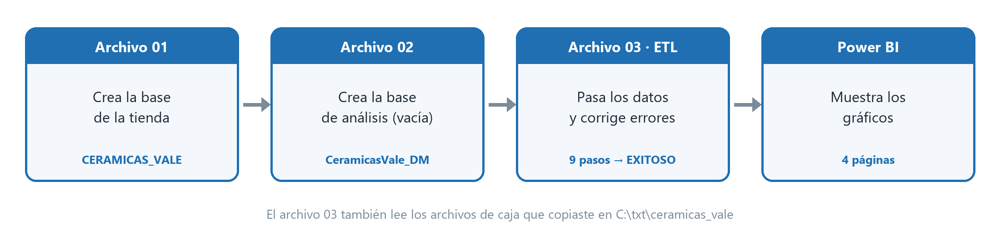
*Los cuatro pasos de la Parte I. Siempre en este orden: 01, 02, 03 y Power BI.*

## 1. Instalar los programas

Si ya los tienes instalados, salta a la sección 2.

### 1.1 SQL Server

1. Entra a **microsoft.com/es-es/sql-server/sql-server-downloads** y descarga la edición **Developer** (o **Express**).
2. Abre el instalador y elige **Básica**. Acepta la licencia y espera a que termine (unos 10 minutos).
3. Al final aparece el **nombre de la instancia**. Anótalo:
   – si dice `MSSQLSERVER`, tu servidor se llama `localhost` (o un punto: `.`);
   – si dice `SQLEXPRESS`, tu servidor se llama `.\SQLEXPRESS`.

### 1.2 SQL Server Management Studio (SSMS)

1. Entra a **learn.microsoft.com/es-es/ssms/install/install**, descarga `vs_SSMS.exe` y ejecútalo. Pulsa **Instalar**.
2. Abre SSMS. Aparece la ventana **Conectar al servidor**.
3. En **Nombre del servidor** escribe el nombre que anotaste. En **Autenticación** deja *Autenticación de Windows*.
4. Marca la casilla **Confiar en el certificado del servidor** y pulsa **Conectar**.

> **✅ ¿Salió bien?** A la izquierda aparece el **Explorador de objetos** con el nombre de tu servidor.

> **⚠️ Ojo** Si sale un error que habla de *certificado* o *entidad que no es de confianza*, te faltó marcar **Confiar en el certificado del servidor**.

### 1.3 Power BI Desktop

1. Abre **Microsoft Store**, busca **Power BI Desktop** y pulsa **Obtener**.
2. Ábrelo una vez para ver que inicia. No hace falta iniciar sesión: cierra la ventana que lo pide.

## 2. Descargar el proyecto

1. Entra a **github.com/brvnomk/BIG-DATA**.
2. Arriba a la derecha de la lista de archivos hay un botón **verde** que dice **Code**. Púlsalo: se abre un menú, y abajo de todo está **Download ZIP**. Púlsalo y se descarga un archivo .zip.
3. Descomprime el ZIP en el **Escritorio** (clic derecho → *Extraer todo*). Te queda una carpeta llamada `BIG-DATA-main`.

> **✅ ¿Salió bien?** En el Escritorio tienes la carpeta `BIG-DATA-main` con las carpetas `SQL SCRIPTS`, `TXT`, `VISUAL`, `BIG_DATA` y las demás.

## 3. Copiar los archivos de caja a C:\txt\ceramicas_vale

El ETL lee unos archivos de texto que simulan lo que exporta la caja de la tienda. SQL Server los busca **siempre en la misma carpeta**, por eso hay que copiarlos ahí.

1. Abre el **Explorador de archivos** y entra a **Disco local (C:)**.
2. Crea una carpeta llamada `txt` (clic derecho → *Nuevo* → *Carpeta*).
3. Dentro de `txt`, crea otra carpeta llamada `ceramicas_vale`.
4. Copia ahí los **5 archivos** que están en `BIG-DATA-main\TXT\ceramicas_vale`.

```
C:\txt\ceramicas_vale\metodopago.txt
C:\txt\ceramicas_vale\operacionVenta.txt
C:\txt\ceramicas_vale\operacionVenta_10000.txt
C:\txt\ceramicas_vale\operacionVenta_500000.txt
C:\txt\ceramicas_vale\operacionVenta_1000000.txt
```

> **✅ ¿Salió bien?** Al abrir `C:\txt\ceramicas_vale` ves los 5 archivos.

## 4. Cómo se ejecuta un archivo en SSMS (lo vas a repetir varias veces)

Las secciones 5, 6 y 7 se hacen igual: **abrir un archivo y presionar F5**. Míralo una vez aquí:

1. En SSMS, arriba a la izquierda: **Archivo → Abrir → Archivo…** y busca el archivo `.sql` en la carpeta del proyecto. Aparece mucho texto: es normal, **no cambies nada**.
2. Presiona **F5** o el botón **▶ Ejecutar** (recuadro 1).
3. Cuando termina, abajo aparecen las pestañas **Resultados** y **Mensajes** (recuadro 2) y la barra amarilla dice **Consulta ejecutada correctamente** (recuadro 3).

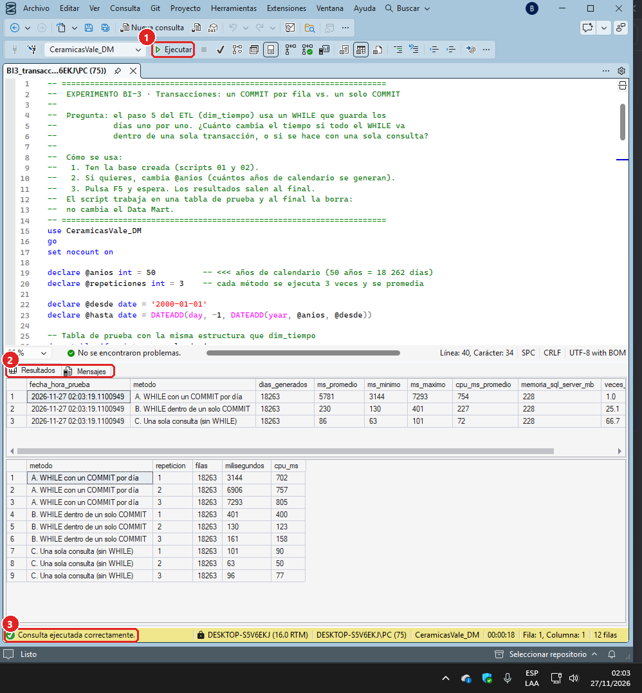
*Un script ejecutado en SSMS: (1) botón Ejecutar, (2) pestañas de resultados y (3) mensaje de que terminó bien.*

> **💡 Consejo** Si la barra de abajo sale en **rojo**, lee el mensaje de la pestaña **Mensajes** y búscalo en la sección 11.

## 5. Crear la base de datos de la tienda (archivo 01)

1. Abre `SQL SCRIPTS\01_base_transaccional.sql` (como en la sección 4).
2. Presiona **F5** y espera unos 10 segundos.

> **✅ ¿Salió bien?** En **Resultados** aparece una tabla con **100000** en *ventas* y **250203** en *lineas_detalle*. Son siempre esos números, en cualquier computadora.

## 6. Crear la base de datos de análisis (archivo 02)

1. Abre `SQL SCRIPTS\02_crear_entorno_etl.sql`.
2. Presiona **F5**.

> **✅ ¿Salió bien?** En **Mensajes** dice *Los comandos se han completado correctamente*. No aparece ninguna tabla: es normal, la base está vacía.

## 7. Pasar los datos a la base de análisis (archivo 03, el ETL)

Este archivo copia los datos de la base de la tienda a la base de análisis y **corrige los errores** que encuentra: nombres mal escritos, datos vacíos, ventas anuladas o repetidas.

1. Revisa que `C:\txt\ceramicas_vale` tenga los 5 archivos (sección 3). Si no están, este paso falla.
2. Abre `SQL SCRIPTS\03_ETL_CARGA.sql` y presiona **F5**. Tarda unos segundos.
3. En **Resultados** aparecen varias tablas. Baja hasta la que tiene la columna *proceso*.

> **✅ ¿Salió bien?** La tabla tiene **9 filas EXITOSO** y la última, *9. Reconciliación*, dice **OK**: el total vendido es igual en las dos bases, no se perdió ni se duplicó ninguna venta.

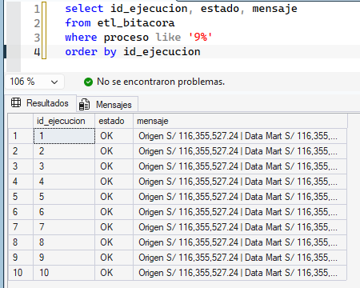
*La reconciliación: el total del origen y el del Data Mart coinciden, y el estado es OK.*

> **💡 Consejo** Puedes ejecutar el archivo 03 todas las veces que quieras: cada vez borra y vuelve a cargar todo, sin duplicar datos.

## 8. Ver el dashboard en Power BI

1. Entra a `VISUAL\POWER BI` y haz doble clic en `Ceramicas Vale.pbix`. Se abre Power BI.
2. En la pestaña **Inicio**, pulsa **Actualizar**.
3. Si pide credenciales: elige **Windows** a la izquierda, marca **Usar mis credenciales actuales** y pulsa **Conectar**. Si sale un aviso de conexión *no cifrada*, pulsa **Aceptar**.
4. Espera a que se cierre la ventana **Cargar**.

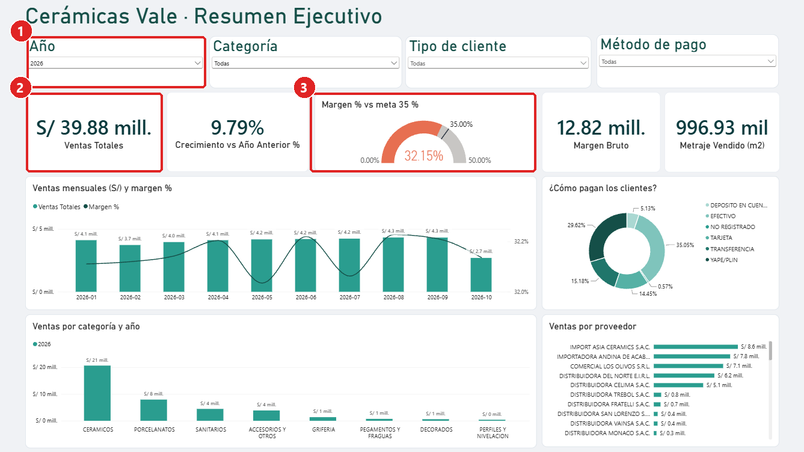
*Página Resumen Ejecutivo: (1) filtro Año, (2) tarjeta Ventas Totales y (3) margen frente a la meta de 35 %.*

> **✅ ¿Salió bien?** Con el filtro **Año** en *2026* (recuadro 1), **Ventas Totales** dice **S/ 39.88 mill.** y el margen **32.15 %**. Si eliges *Todas*, Ventas Totales dice **S/ 116.36 mill.**

> **⚠️ Ojo** Actualiza siempre con **Inicio → Actualizar**. Si haces clic derecho sobre una tabla para actualizarla sola puede salir un error de *referencia cíclica*. Y Power BI **no se actualiza solo**: si vuelves a ejecutar el archivo 03, pulsa otra vez Actualizar.

| Página (pestañas de abajo) | Qué responde |
| --- | --- |
| Resumen Ejecutivo | ¿Cuánto se vende, crece y se llega a la meta de margen de 35 %? |
| ETL | ¿La carga de datos funcionó? ¿Qué errores corrigió? |
| Almacén y Rotación | ¿Qué productos ocupan espacio sin venderse? ¿Cuáles hay que reponer? |
| Clientes y Demanda | ¿Quiénes compran, en qué distritos y qué días? |

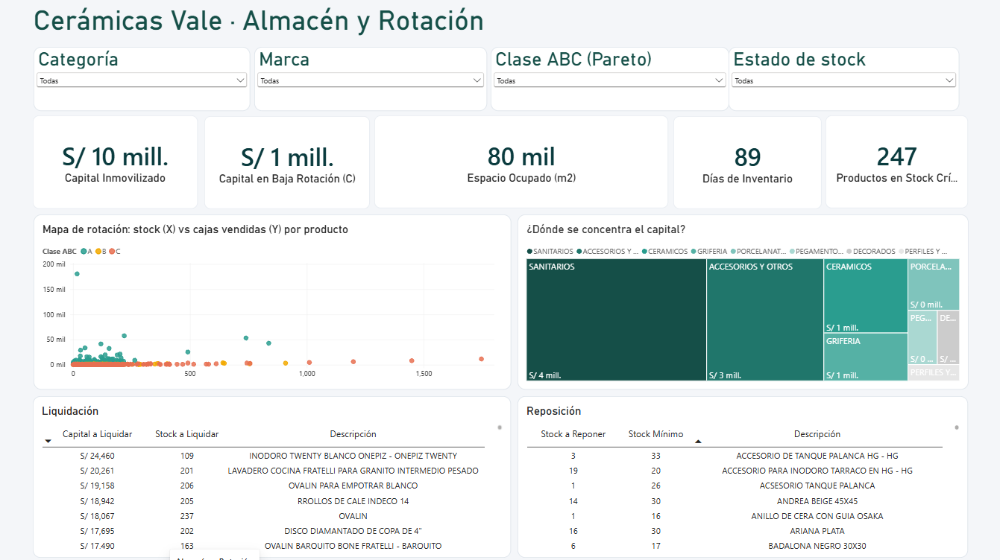
*Página Almacén y Rotación: capital inmovilizado, productos en stock crítico y listas de reposición y liquidación.*

## 9. Comprobación final de la Parte I

Si estos números coinciden, **lo hiciste bien**. El tiempo que tarda cada paso depende de la computadora; eso no importa.

| Dónde mirar | Qué debe decir |
| --- | --- |
| Sección 5 · pestaña Resultados | 100000 ventas y 250203 líneas de detalle |
| Sección 7 · tabla con la columna *proceso* | 9 filas EXITOSO y la última con OK |
| Sección 8 · Ventas Totales (Año = Todas) | S/ 116.36 mill. |
| Sección 8 · Margen (Año = Todas) | 32.16 %, por debajo de la meta de 35 % |

## 10. Opcional: que el ETL se ejecute solo cada noche

En la tienda, el ETL debería correr solo cada noche, después del cierre de caja. La guía completa está en `AUTOMATIZACION\AUTOMATIZACION_ETL.md`. La forma más simple:

1. Copia `AUTOMATIZACION\ejecutar_etl.bat` dentro de la carpeta del proyecto, junto a `SQL SCRIPTS`.
2. Abre el **Programador de tareas** de Windows → **Crear tarea básica**. Nombre: `ETL Ceramicas Vale`.
3. Desencadenador: **Diariamente**, a las 23:05. Acción: **Iniciar un programa** → elige `ejecutar_etl.bat`.
4. Para probarla: clic derecho sobre la tarea → **Ejecutar**.

> **✅ ¿Salió bien?** En SSMS, esta consulta muestra una ejecución nueva con estado EXITOSO:

```
select top 5 * from CeramicasVale_DM.dbo.etl_ejecucion order by id_ejecucion desc
```

## 11. Si algo sale mal en la Parte I

| Qué pasa | Qué hacer |
| --- | --- |
| Error de *certificado* al conectar SSMS | Marca **Confiar en el certificado del servidor** y vuelve a conectar |
| El archivo 03 dice que *no se puede abrir* un .txt | Faltan archivos en `C:\txt\ceramicas_vale`. Repite la sección 3 |
| El archivo 03 dice *nombre de objeto no válido* | Te saltaste el 01 o el 02. Ejecuta los tres en orden: 01, 02 y 03 |
| En la sección 5 no salen 100000 y 250203 | Se cambió algo del archivo 01. Vuelve a descargarlo |
| Un paso tarda mucho | Poca memoria libre: cierra el navegador y otros programas y repite |
| Power BI dice *referencia cíclica* | Actualiza con **Inicio → Actualizar**, no tabla por tabla |
| Power BI muestra números viejos | Falta pulsar **Inicio → Actualizar** después del archivo 03 |
| Power BI no se conecta | Tu servidor tiene otro nombre. **Transformar datos → Configuración de origen de datos → Cambiar origen** y escribe el nombre que usas en SSMS (por ejemplo `.\SQLEXPRESS`) |

# Parte II · Experimentos de la solución BI

Son los 4 experimentos de la sección 6.7 del informe. En cada uno se cambia **una sola cosa** y se mide el tiempo. Los scripts están en `EXPERIMENTOS\BI`. Tus tiempos van a ser distintos a los nuestros porque dependen de la computadora: lo importante es que la **comparación** salga parecida (qué método gana y por cuánto).

## 12. Antes de cualquier experimento

1. Ten la **Parte I terminada** (sección 9 comprobada).
2. **Cierra** Power BI, el navegador y otros programas pesados, y conecta la laptop al cargador. Con programas abiertos, los tiempos salen más altos.
3. Toma nota de tu computadora: en SSMS abre una consulta nueva (**Nueva consulta**), pega esto y presiona **F5**. Toma una captura del resultado.

```
select cpu_count nucleos, physical_memory_kb / 1024 / 1024 memoria_gb, @@VERSION version
from sys.dm_os_sys_info
```

> **💡 Consejo** Toma todas las capturas en **pantalla completa**, con el reloj de Windows visible: así queda la fecha y la hora como evidencia.

## 13. BI-1 · ¿Qué pasa si el negocio vende cada vez más?

**Qué probamos:** cargamos **10 mil, 100 mil, 500 mil y 1 millón** de ventas y medimos cuánto tarda el ETL con cada volumen. La meta del proyecto es que tarde **menos de 60 segundos**.

**Lo que esperamos:** que tarde más con más ventas, pero siempre menos de 60 s.

Repite los pasos 1 a 3 **cuatro veces**: con `10000`, `100000`, `500000` y `1000000`, en ese orden.

1. Abre `BI1_paso1_generar_ventas.sql`. En la línea `declare @ventas int = 10000` escribe el volumen y presiona **F5**. Abajo aparece el nombre del archivo de caja que le corresponde.
2. Abre `03_ETL_CARGA.sql`, presiona **Ctrl + G**, escribe **188** y Enter. En esa línea cambia el nombre del archivo por el que te dio el paso 1 (sin borrar las comillas) y guarda con **Ctrl + S**.
3. Presiona **F5 tres veces** en el archivo 03, esperando que termine cada una.
4. Cuando termines los 4 volúmenes, abre `BI1_paso3_resultados.sql` y presiona **F5**: esas dos tablas son tus resultados.
5. **Deja todo como estaba:** en el paso 1 pon `100000` y F5; en la línea 188 del archivo 03 pon `operacionVenta.txt`, guarda y presiona F5 una vez.

> **💡 Consejo** Con 1 millón el paso 1 tarda casi un minuto. Todo el experimento toma unos 10 minutos.

| Ventas | Filas en la tabla de hechos | Tiempo promedio (nuestro) | Filas por segundo |
| --- | --- | --- | --- |
| 10 000 | 24 387 | 3.45 s | 7 068 |
| 100 000 | 242 023 | 5.06 s | 47 792 |
| 500 000 | 1 183 472 | 20.47 s | 57 806 |
| 1 000 000 | 2 327 810 | 41.27 s | 56 404 |

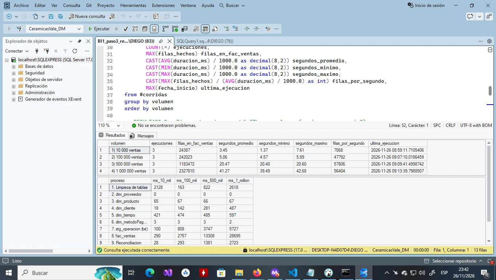
*Resultado del BI-1: tiempo por volumen y tiempo de cada paso del ETL.*

> **✅ ¿Salió bien?** Las **filas de hechos** son exactamente las de la tabla (24 387, 242 023…) y con 1 millón el tiempo queda por debajo de 60 s.

## 14. BI-2 · ¿Fila por fila o todo de una vez?

**Qué probamos:** un **cursor** recorre una tabla **fila por fila**. Una consulta **por conjuntos** (`INSERT … SELECT`) procesa **todas las filas a la vez**, como lo hace nuestro ETL. Es como copiar una lista de 240 mil nombres: el cursor los copia uno por uno a mano; la consulta saca una fotocopia de toda la lista.

**Lo que esperamos:** que el cursor sea mucho más lento.

1. Abre `BI2_cursor_vs_conjunto.sql`.
2. Presiona **F5** y espera (menos de 1 minuto).
3. Toma la captura de las tablas de resultados del final.

| Método | Filas | Tiempo (nuestro) | CPU |
| --- | --- | --- | --- |
| A. Por conjuntos (INSERT…SELECT) | 242 023 | 0.49 s | 0.49 s |
| B. Fila por fila (CURSOR) | 242 023 | 45.16 s | 19.73 s |

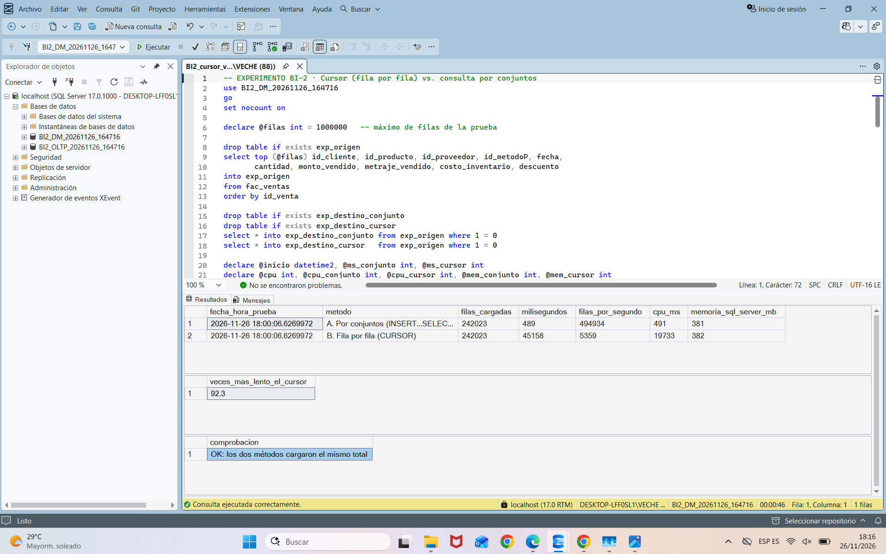
*Resultado del BI-2: el cursor tarda mucho más para cargar las mismas filas.*

> **✅ ¿Salió bien?** El cursor es **decenas de veces más lento** (en nuestra prueba, 92 veces) y la última tabla confirma que los dos métodos cargaron **el mismo total**.

> **💡 Consejo** El script trabaja en tablas de prueba y las borra al terminar: no cambia nada de tu base.

## 15. BI-3 · ¿Guardar día por día o todo al final?

**Qué probamos:** el paso 5 del ETL arma el calendario con un **WHILE** que guarda los días **uno por uno**, y cada día se confirma por separado (un `COMMIT` por día). El script genera 50 años de calendario (18 263 días) de tres formas: **A.** un COMMIT por día; **B.** el mismo WHILE dentro de **una sola transacción**; **C.** **una sola consulta**, sin WHILE. Es como escribir un documento y pulsar *Guardar* después de cada línea (A) o una sola vez al final (B).

**Lo que esperamos:** que B y C sean mucho más rápidos que A.

1. Abre `BI3_transacciones.sql`.
2. Presiona **F5** y espera unos 10 segundos (cada forma se ejecuta 3 veces).
3. Toma la captura de las dos tablas de resultados.

| Forma | Tiempo promedio (nuestro) | Veces más rápido que A |
| --- | --- | --- |
| A. WHILE con un COMMIT por día | 3 402 ms | 1 |
| B. WHILE dentro de un solo COMMIT | 178 ms | 19.1 |
| C. Una sola consulta | 215 ms | 15.8 |

> **✅ ¿Salió bien?** La forma **A** es la más lenta por mucho. B y C tardan menos de medio segundo.

## 16. BI-4 · Power BI: ¿Importar o DirectQuery?

**Qué probamos:** al conectar Power BI a SQL Server hay dos modos. **Importar** copia los datos dentro del archivo `.pbix`; **DirectQuery** no copia nada y le pregunta a SQL Server cada vez que se muestra un gráfico. Hacemos **los mismos 4 gráficos** en dos archivos, uno con cada modo, y comparamos: qué tan rápido responden, cuánto pesa el archivo y si los datos se ven al día.

**Lo que esperamos:** Importar responde más rápido pero pesa más; DirectQuery siempre muestra los datos al día.

### A. Archivo con Importar

1. Abre Power BI Desktop → **Informe en blanco**.
2. **Inicio → Obtener datos → SQL Server.** Servidor: `.` (un punto). Base de datos: `CeramicasVale_DM`. Modo: **Importar**. Pulsa **Aceptar** (si pide credenciales: **Windows → Usar mis credenciales actuales → Conectar**).
3. Marca `fac_ventas`, `dim_tiempo`, `dim_producto` y `dim_metodoPago` y pulsa **Cargar**.
4. Crea los 4 gráficos de la tabla de abajo (elige el tipo en *Visualizaciones* y arrastra los campos).
5. Guarda como `BI4_importar.pbix`.
6. Menú **Ver → Analizador de rendimiento**. Pulsa **Iniciar grabación** y luego **Actualizar objetos visuales** (recuadro 1). Cada gráfico aparece con su tiempo en milisegundos (recuadro 2). Toma la captura.

| Gráfico | Campos |
| --- | --- |
| Tarjeta | `monto_vendido` (de fac_ventas) |
| Columnas agrupadas | Eje X: `categoria` (de dim_producto) · Eje Y: `monto_vendido` |
| Líneas | Eje X: `mes` (de dim_tiempo) · Eje Y: `monto_vendido` |
| Anillo | Leyenda: `nombreMetodo` (de dim_metodoPago) · Valores: `monto_vendido` |

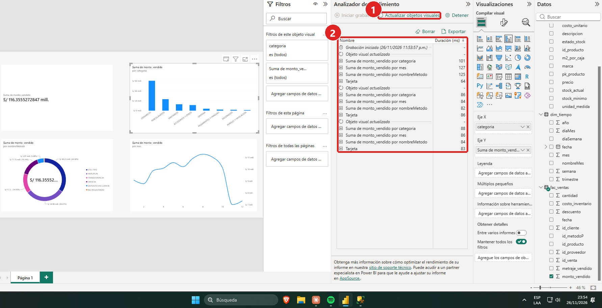
*Analizador de rendimiento: (1) Actualizar objetos visuales y (2) milisegundos de cada gráfico.*

### B. Archivo con DirectQuery

1. Repite todo lo anterior, pero en el paso 2 elige **DirectQuery** y guarda como `BI4_directquery.pbix`. Aquí aparece una fila más, *Consulta directa*: es lo que tardó SQL Server en responder.

### C. Peso de los archivos y D. ¿datos al día?

1. Cierra Power BI. Clic derecho sobre cada `.pbix` → **Propiedades** y toma la captura del **Tamaño**.
2. Abre los dos archivos. En SSMS ejecuta este cambio de prueba, que suma 1 millón de soles a una venta:

```
update top (1) CeramicasVale_DM.dbo.fac_ventas set monto_vendido = monto_vendido + 1000000
```

1. En cada archivo pulsa **Actualizar objetos visuales** (no *Inicio → Actualizar*) y mira la tarjeta: con DirectQuery el total sube 1 millón; con Importar se queda igual.
2. **Deshaz el cambio** ejecutando una vez el archivo 03.

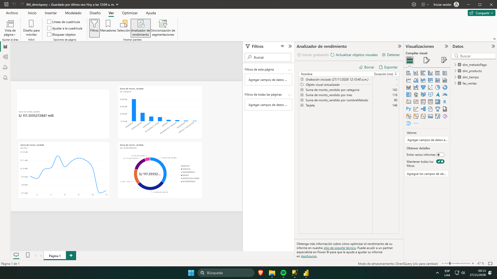
*Con DirectQuery la tarjeta muestra el millón sumado al instante (S/ 117.36 mill.).*

| Qué se mide | Importar (nuestro) | DirectQuery (nuestro) |
| --- | --- | --- |
| Tiempo promedio por gráfico | 85 ms | 148 ms |
| Peso del archivo | 4.56 MB | 33.5 KB |
| Tarjeta tras el cambio | S/ 116.36 mill. (sin cambio) | S/ 117.36 mill. (al instante) |

## 17. Si algo sale mal en los experimentos BI

| Qué pasa | Qué hacer |
| --- | --- |
| El archivo 03 dice *no se puede abrir el archivo* | Falta el .txt en `C:\txt\ceramicas_vale` o está mal escrito en la línea 188 |
| En el BI-1 tu volumen sale como *otro volumen* | La línea 188 tenía el archivo de otro volumen. Corrígela y ejecuta el 03 otra vez |
| El archivo 03 termina en ERROR | Mira la tabla de pasos del final: dice cuál falló |
| Los tiempos cambian mucho entre ejecuciones | Hay programas abiertos. Ciérralos y repite |
| Power BI no conecta | Escribe el mismo nombre de servidor que usas en SSMS |

# Parte III · Solución Big Data (Databricks)

Aquí procesamos **los mismos datos de ventas** en Databricks, con Spark, y guardamos el resultado en tres capas: **Bronze** (los datos tal como llegan), **Silver** (los datos limpios) y **Gold** (las tablas listas para los gráficos). Al final, el notebook compara su total con el de SQL Server: si coinciden, todo está bien. Toma unos 30 minutos.

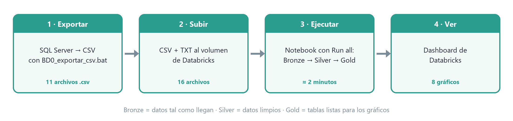
*Los cuatro pasos de la Parte III.*

> **⚠️ Ojo** Necesitas la **Parte I terminada**, porque los datos se exportan desde la base `CERAMICAS_VALE` de SQL Server.

## 18. Crear tu cuenta de Databricks (gratis)

1. Entra a **databricks.com/learn/free-edition** y pulsa **Sign up** (o *Get started*).
2. Regístrate con tu correo (puedes usar **Continue with Google**). No pide tarjeta.
3. Espera a que se cree tu espacio de trabajo (1 o 2 minutos). Se abre la página de inicio de Databricks.

> **✅ ¿Salió bien?** Ves el menú de la izquierda con **Workspace**, **Catalog**, **Dashboards** y otros.

> **💡 Consejo** Databricks está en inglés. En este documento ponemos los nombres de los botones tal como aparecen en pantalla.

## 19. Exportar los datos de SQL Server a archivos CSV

Databricks no se conecta a tu SQL Server: hay que llevarle los datos en archivos. Un archivo del proyecto lo hace solo.

1. Entra a la carpeta `BIG_DATA` del proyecto.
2. Haz **doble clic** en `BD0_exportar_csv.bat`. Se abre una ventana negra que va mostrando su avance.
3. Espera unos **3 minutos**. Genera 10 mil, 100 mil, 500 mil y 1 millón de ventas, las exporta y al final deja la base otra vez con 100 000 ventas.
4. Cuando diga *Presione una tecla para continuar*, presiona cualquier tecla.

> **✅ ¿Salió bien?** En `C:\csv\ceramicas_vale` hay **11 archivos .csv**: `proveedores`, `productos`, `clientes` y `ventas_…` y `detalle_ventas_…` de cada volumen.

> **⚠️ Ojo** Si tu servidor no es el local (por ejemplo `.\SQLEXPRESS`), abre el `.bat` con el Bloc de notas y cambia la línea `set SERVIDOR=.` por tu nombre de servidor.

## 20. Crear la carpeta del proyecto en Databricks

1. En el menú de la izquierda haz clic en **Catalog**.
2. En la lista, haz clic en **workspace**.
3. Arriba a la derecha pulsa el botón **Create** y, en el menú, **Schema**. Se abre una ventanita: en el nombre escribe `ceramicas_vale` y pulsa **Create**.
4. Haz clic en `ceramicas_vale` (aparece en la lista, debajo de *workspace*). Pulsa otra vez **Create** y ahora elige **Volume**. Nombre: `datos`. Pulsa **Create**.

> **✅ ¿Salió bien?** Dentro de *workspace* está `ceramicas_vale`, y dentro de él, el volumen `datos`.

> **⚠️ Ojo** Escribe los nombres **exactamente** así, en minúsculas: `ceramicas_vale` y `datos`. El notebook los busca con esos nombres.

## 21. Subir los 16 archivos

1. Haz clic en el volumen `datos`. Arriba a la derecha aparece el botón **Upload to this volume**: púlsalo y se abre una ventana para soltar archivos.
2. Arrastra los **11 CSV** de `C:\csv\ceramicas_vale` y los **5 TXT** de `C:\txt\ceramicas_vale`.
3. Espera a que terminen de subir. El detalle de 1 millón pesa unos 76 MB y tarda un poco.

> **✅ ¿Salió bien?** En el volumen `datos` ves **16 archivos**.

## 22. Traer el notebook a Databricks

1. En el menú de la izquierda haz clic en **Workspace** y entra a tu carpeta (**Home**).
2. Arriba a la derecha pulsa los tres puntos **⋮** (o **Create**) → **Import**.
3. Se abre la ventana **Import**. Deja marcada la opción **File**, arrastra al recuadro el archivo `BIG_DATA\notebooks\01_ETL_Medallion_CeramicasVale.py` y pulsa el botón **Import** de abajo.

> **✅ ¿Salió bien?** Se abre el notebook con su título y sus celdas.

## 23. Ejecutar el notebook

1. Arriba aparece el cuadro **1. Volumen de ventas** (recuadro 1). Elige el volumen; para empezar, `100000`.
2. Pulsa **Run all** (recuadro 2).
3. Si arriba a la derecha dice **Connect**, elige **Serverless** (recuadro 3). Normalmente se conecta solo.
4. Espera a que terminen todas las celdas (**unos 2 minutos**). La celda que se está ejecutando muestra un reloj; al terminar, debajo aparecen sus resultados.

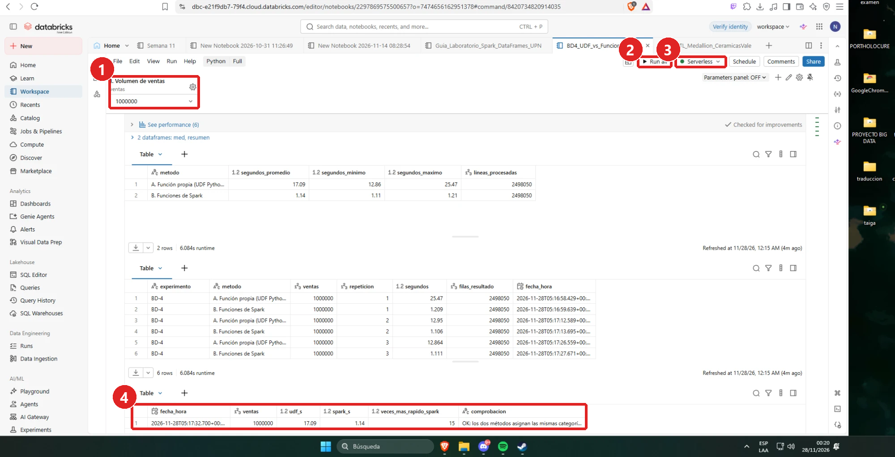
*Un notebook en Databricks: (1) volumen de ventas, (2) Run all, (3) Serverless y (4) resultado final con OK.*

> **💡 Consejo** Si no aparece el cuadro *1. Volumen de ventas*, pulsa **Run all** una vez más: se crea al ejecutar la primera celda.

## 24. Comprobar que salió bien

Baja por el notebook y revisa estas tres cosas:

1. En la sección **2. Capa Bronze**: la línea *1. Bronze: carga de archivos … EXITOSO* (recuadro 1) y la tabla con las 7 tablas cargadas (recuadro 2).
2. En la sección **6. Reconciliación**: la línea *Origen S/ … | Databricks S/ … | Diferencia S/ 0.0000* y *Ejecución N: EXITOSO* (recuadro 1), y la tabla con los 9 pasos en EXITOSO (recuadro 2).
3. En las secciones **7. Calidad** y **8. Indicadores**: la tabla de antes y después de la limpieza (todo en 0 después) y las tablas de ventas por mes, categoría, método de pago, etc.

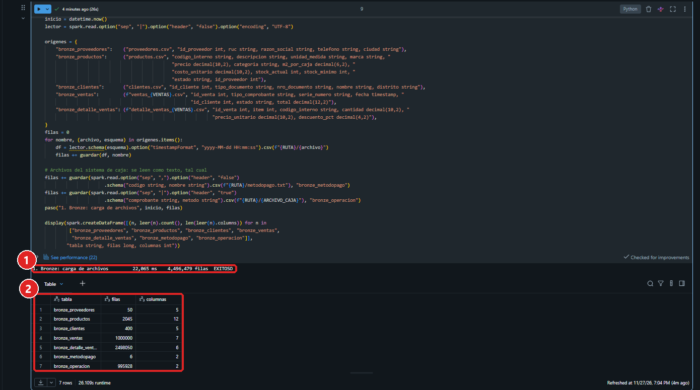
*Capa Bronze con 1 000 000 de ventas: (1) paso EXITOSO y (2) las 7 tablas con sus filas.*

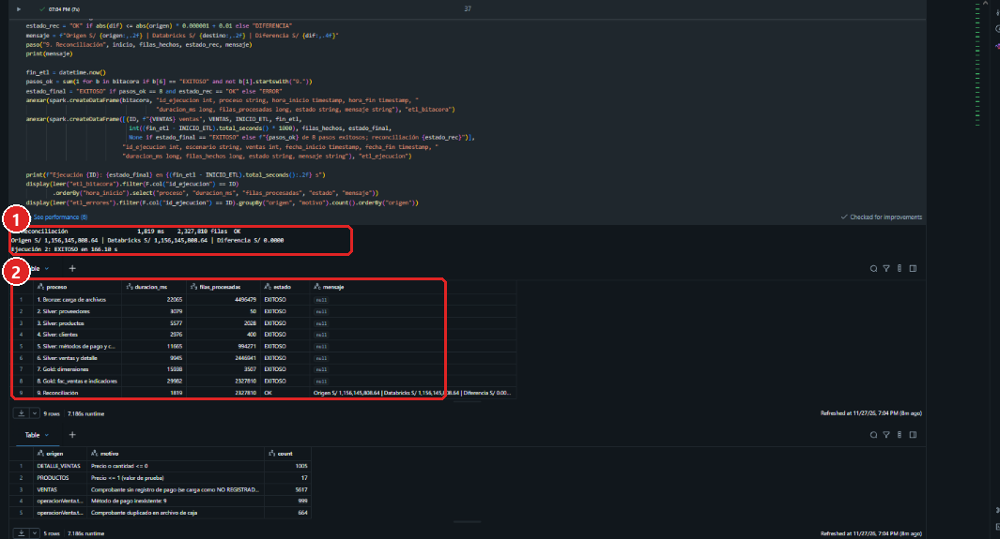
*Reconciliación: (1) la diferencia con SQL Server es S/ 0.0000 y la ejecución es EXITOSA; (2) los 9 pasos con su tiempo.*

| Volumen elegido | Filas en fac_ventas | Reconciliación |
| --- | --- | --- |
| 10 000 | 24 387 | OK |
| 100 000 | 242 023 | OK |
| 500 000 | 1 183 472 | OK |
| 1 000 000 | 2 327 810 | OK (diferencia S/ 0.00) |

> **✅ ¿Salió bien?** Las filas de `fac_ventas` son **exactamente** las de la tabla, iguales a las de SQL Server, y la reconciliación dice **OK**.

## 25. Armar el dashboard en Databricks

1. En el menú de la izquierda: **Dashboards → Create dashboard**.
2. Pestaña **Data → Add data source**, entra a `workspace` → `ceramicas_vale` y agrega las 7 tablas que empiezan con `kpi_`.
3. Vuelve a la pestaña **Canvas** y pulsa **Add a visualization**: aparece un recuadro vacío en la hoja. Con el recuadro seleccionado, a la derecha se abre un panel: arriba eliges la **tabla** (Dataset), luego el tipo (**Visualization**: Bar, Line o Pie) y abajo los campos de cada eje. Repite por cada gráfico de la tabla de abajo.
4. Ponle un título (por ejemplo *Cerámicas Vale – Indicadores (Big Data)*) y pulsa **Publish**.

| Gráfico | Tabla | Tipo | Campos |
| --- | --- | --- | --- |
| Ventas por mes | kpi_ventas_mes | Line | X: mes · Y: ventas · Color: anio |
| Ventas por categoría | kpi_categoria | Bar | X: categoria · Y: ventas |
| Margen por categoría | kpi_categoria | Bar | X: categoria · Y: margen_pct |
| Cómo pagan los clientes | kpi_metodo_pago | Pie | Angle: ventas · Color: nombreMetodo |
| Top proveedores | kpi_proveedores | Bar | X: razon_social · Y: ventas |
| Clientes VIP vs. regulares | kpi_clientes | Pie | Angle: ventas · Color: tipo_cliente |
| Ventas por día | kpi_dia_semana | Bar | X: diaSemana · Y: ventas |
| Productos por agotarse | kpi_stock_critico | Bar | X: categoria · Y: productos_criticos |

> **💡 Consejo** Los gráficos de pastel (**Pie**) no tienen eje X ni Y: en su lugar piden **Angle** (el tamaño de cada tajada) y **Color** (qué representa cada tajada).

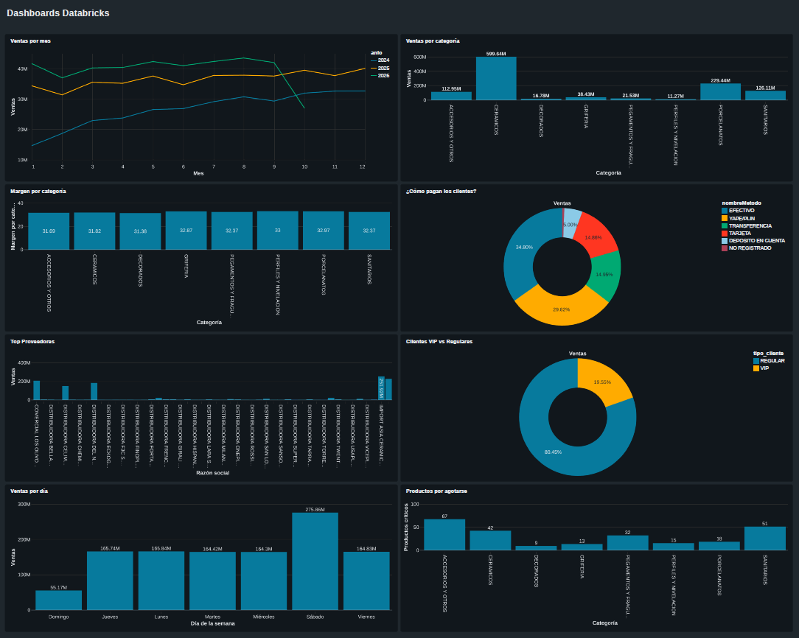
*El dashboard terminado, con 1 000 000 de ventas.*

## 26. Si algo sale mal en la Parte III

| Qué pasa | Qué hacer |
| --- | --- |
| *Faltan estos archivos* o *PATH_NOT_FOUND* | Falta subir ese archivo al volumen `datos` (sección 21) o el volumen tiene otro nombre |
| *SCHEMA_NOT_FOUND* | Falta crear el esquema `ceramicas_vale` (sección 20) |
| El .bat dice que no encuentra `bcp` o `sqlcmd` | Vienen con SQL Server. Reinicia la computadora después de instalarlo y vuelve a probar |
| El .bat no se conecta | Cambia `set SERVIDOR=.` por tu nombre de servidor (sección 19) |
| No aparece el cuadro *1. Volumen de ventas* | Pulsa **Run all** otra vez |
| Pide conectarse a algo | Arriba a la derecha: **Connect → Serverless** |
| Una celda sale en rojo | Lee la última línea del error; casi siempre es un archivo o un nombre mal escrito |
| Un menú tiene otro nombre | Databricks cambia a veces los nombres: busca el más parecido |

# Parte IV · Experimentos de Big Data

Son los 4 experimentos de la sección 6.8 del informe. Necesitas la Parte III hasta la sección 21 (cuenta, esquema, volumen y archivos subidos). Cada experimento es un notebook de la carpeta `BIG_DATA\notebooks`: se importa igual que en la sección 22, se deja el volumen en `1000000` y se pulsa **Run all**.

> **💡 Consejo** Databricks gratis comparte sus máquinas con otros usuarios, así que tus tiempos pueden variar. Lo importante es la **comparación** y que la última tabla diga **OK** en la columna *comprobacion*.

## 27. BD-1 · ¿Cómo crece el tiempo cuando hay más ventas?

**Qué probamos:** ejecutamos el notebook principal con 10 mil, 100 mil, 500 mil y 1 millón de ventas y comparamos cuánto tarda todo el proceso (Bronze → Silver → Gold).

**Lo que esperamos:** que el tiempo crezca mucho menos que el volumen, porque Spark reparte el trabajo.

1. Usa el notebook `01_ETL_Medallion_CeramicasVale` de la Parte III.
2. Ejecútalo con **Run all** cambiando el cuadro *1. Volumen de ventas* cada vez: `10000`, `100000`, `500000` y `1000000`. Si quieres más precisión, repite cada volumen varias veces (nosotros lo hicimos 4 veces).
3. Baja hasta la sección **9. Experimento BD-1**: la primera tabla resume todas las ejecuciones por volumen.

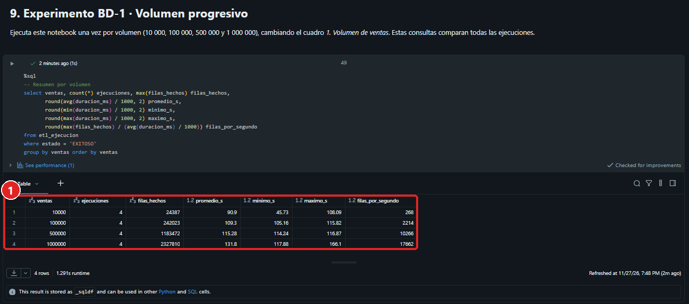
*Resumen del BD-1: ejecuciones, filas, tiempo promedio, mínimo, máximo y filas por segundo de cada volumen.*

| Ventas | Filas de hechos | Tiempo promedio (nuestro) |
| --- | --- | --- |
| 10 000 | 24 387 | 90.9 s |
| 100 000 | 242 023 | 109.3 s |
| 500 000 | 1 183 472 | 115.3 s |
| 1 000 000 | 2 327 810 | 131.8 s |

> **✅ ¿Salió bien?** El volumen crece 100 veces y el tiempo apenas 1,5 veces; con 1 millón tarda menos de 5 minutos.

## 28. BD-2 · ¿Leer un archivo CSV o una tabla Delta?

**Qué probamos:** un **CSV** es texto, y Spark tiene que leerlo y convertirlo cada vez. Una **tabla Delta** guarda los datos ya ordenados y comprimidos. El notebook hace la misma consulta (ventas por mes) de las dos formas, 3 veces cada una, y mide también cuánto espacio ocupa cada forma.

**Lo que esperamos:** que Delta sea más rápida y pese menos.

1. Importa `BD2_CSV_vs_Delta.py`, deja el volumen en `1000000` y pulsa **Run all** (unos 2 minutos).
2. Revisa la tabla de la sección **5. Resultados**.

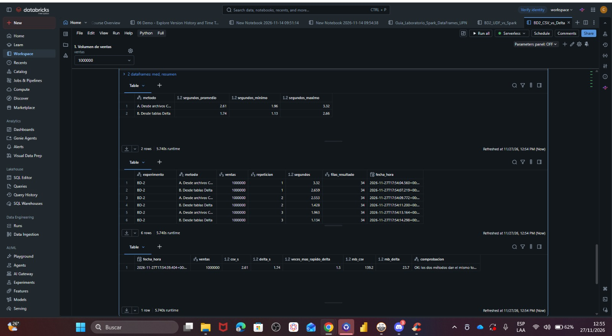
*Resultado del BD-2: tiempo y espacio de cada formato, y comprobación OK.*

| Formato | Tiempo promedio (nuestro) | Espacio |
| --- | --- | --- |
| CSV | 2.61 s | 139.2 MB |
| Tabla Delta | 1.74 s | 23.7 MB |

## 29. BD-3 · ¿En cuántos pedazos conviene dividir los datos?

**Qué probamos:** Spark divide los datos en pedazos llamados **particiones** y trabaja varios a la vez. Con 1 solo pedazo no hay trabajo en paralelo; con demasiados, pierde tiempo organizándolos. El notebook hace el mismo cálculo con 1, 4, 16, 64 y 200 particiones, 3 veces cada uno.

**Lo que esperamos:** que un número intermedio sea el más rápido y 200 el más lento.

1. Importa `BD3_Particiones.py`, deja el volumen en `1000000` y pulsa **Run all**.
2. Revisa la tabla de la sección **3. Resultados**.

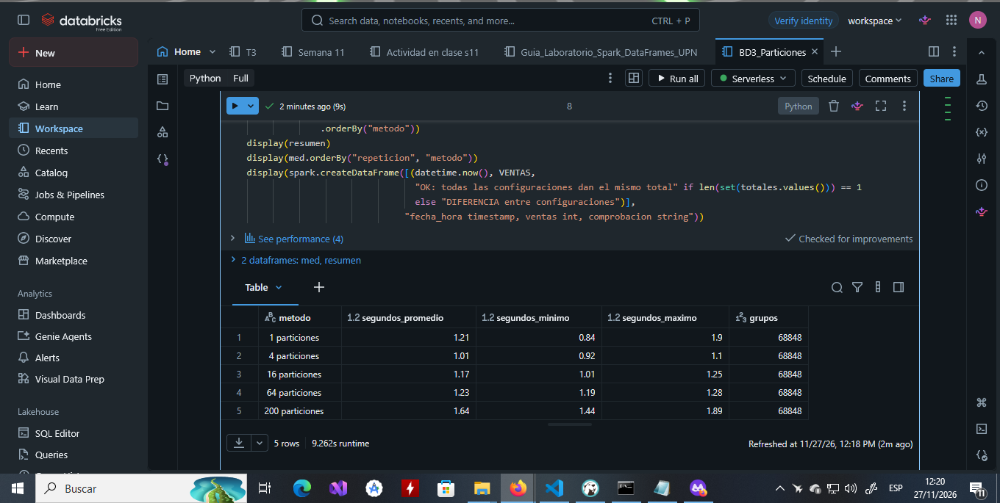
*Resultado del BD-3: tiempo promedio según el número de particiones.*

| Particiones | 1 | 4 | 16 | 64 | 200 |
| --- | --- | --- | --- | --- | --- |
| Tiempo promedio (nuestro) | 1.21 s | 1.01 s | 1.17 s | 1.23 s | 1.64 s |

## 30. BD-4 · ¿Función propia de Python o funciones de Spark?

**Qué probamos:** la limpieza deduce la **categoría** de cada producto a partir de su descripción. Esa regla se puede escribir como una **función propia de Python** (Spark le pasa cada fila a Python, una por una) o con las **funciones que ya trae Spark**, que trabajan dentro de su motor. El notebook la aplica a los 2.5 millones de líneas de venta de las dos formas, 3 veces cada una.

**Lo que esperamos:** que las funciones de Spark sean más rápidas.

1. Importa `BD4_UDF_vs_Funciones_Spark.py`, deja el volumen en `1000000` y pulsa **Run all**.
2. Revisa las tablas de la sección **4. Resultados** (la captura de la sección 23 es justo este experimento).

| Método | Tiempo promedio (nuestro) |
| --- | --- |
| Función propia de Python (UDF) | 17.09 s |
| Funciones de Spark | 1.14 s |

> **✅ ¿Salió bien?** Las funciones de Spark son **unas 15 veces más rápidas** y la comprobación dice **OK: los dos métodos asignan las mismas categorías**.

# Anexos

## Anexo A · Qué hay en cada carpeta del proyecto

| Carpeta o archivo | Qué contiene |
| --- | --- |
| `SQL SCRIPTS/` | Los archivos 01, 02 y 03 de la Parte I |
| `TXT/ceramicas_vale/` | Los archivos de caja que lee el ETL |
| `DATOS/` | El catálogo real de productos (Excel y CSV) |
| `VISUAL/POWER BI/` | El dashboard (`Ceramicas Vale.pbix`) y sus capturas |
| `EXPERIMENTOS/BI/` | Los scripts de los experimentos BI-1 a BI-4 |
| `BIG_DATA/` | `BD0_exportar_csv.bat`, la carpeta `notebooks` (los 4 notebooks), la guía y el diagrama de arquitectura |
| `EVIDENCIAS/` | Capturas de las pruebas y de los 8 experimentos (`EXPERIMENTOS_BI` y `EXPERIMENTOS_BIG_DATA`) |
| `AUTOMATIZACION/` | El archivo para que el ETL corra solo cada noche |
| `DOCUMENTO_DE_REPLICACION` | Este documento (.pdf, .docx y .md) |

## Anexo B · Qué hace el ETL por dentro (para curiosos)

No es necesario para replicar. La base de análisis `CeramicasVale_DM` usa un **modelo estrella**: en el centro, la tabla de ventas `fac_ventas`, y alrededor, cinco tablas que la describen (tiempo, producto, cliente, proveedor y método de pago).

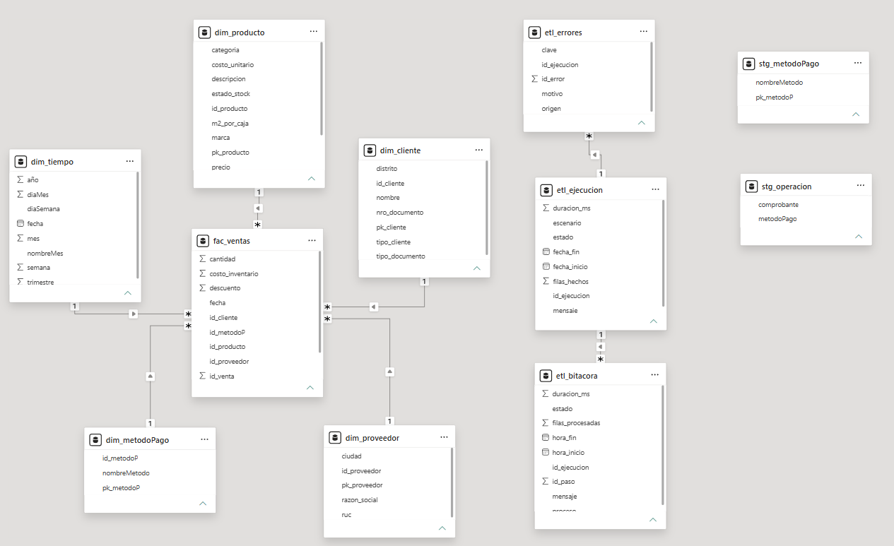
*El modelo estrella en Power BI.*

| Paso | Qué hace | Qué corrige |
| --- | --- | --- |
| 1. Limpieza | Vacía la base de análisis para cargarla de nuevo | — |
| 2. Proveedores | Carga `dim_proveedor` | Mayúsculas; ciudad vacía → NO ESPECIFICADO |
| 3. Productos | Carga `dim_producto` | Deduce la categoría (vacía en 1 957 productos), quita 17 precios de prueba y marca el stock crítico |
| 4. Clientes | Carga `dim_cliente` | Corrige nombres, completa el distrito y marca como VIP al 10 % que más compra |
| 5. Tiempo | Crea el calendario `dim_tiempo` | — |
| 6. Métodos de pago | Lee `metodopago.txt` | Quita espacios y códigos repetidos |
| 7. Caja | Lee `operacionVenta.txt` | Detecta comprobantes repetidos y métodos que no existen |
| 8. Ventas | Carga `fac_ventas` | Excluye ventas anuladas y líneas con precio 0; convierte m² a cajas |
| 9. Reconciliación | Compara el total vendido de las dos bases | Debe dar OK |

En Databricks se hace lo mismo, repartido en capas: **Bronze** guarda los archivos tal como llegan, **Silver** aplica estas mismas correcciones y **Gold** arma el modelo estrella y las tablas `kpi_*` del dashboard. Las ventas se generan con una semilla fija (2026), por eso salen iguales en cualquier computadora.
