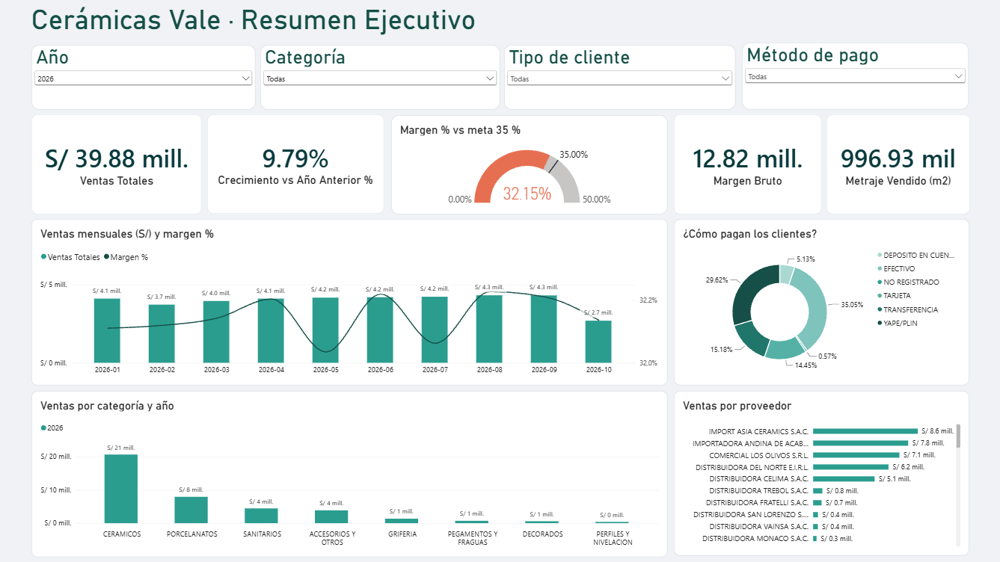

# Cerámicas Vale: base de datos, ETL y dashboard

Proyecto final del curso **Base de Datos Avanzadas y Big Data** (UPN, 2026-2).
Los scripts crean todo desde cero, así que no hace falta tener ninguna otra base de datos.
Herramientas: SQL Server (SSMS 22) y Power BI Desktop para la solución BI; Databricks Free Edition (Apache Spark 4.2.0) para la solución Big Data.

---

## Contenido

- [Estructura del repositorio](#estructura-del-repositorio)
- [Cómo ejecutarlo](#cómo-ejecutarlo)
- [De dónde salen los datos](#de-dónde-salen-los-datos)
- [Modelo estrella](#modelo-estrella)
- [El ETL](#el-etl-03_etl_cargasql)
- [Dashboard](#dashboard-4-páginas)
- [Pruebas con distintos volúmenes](#pruebas-con-distintos-volúmenes)
- [Experimentos de la solución BI](#experimentos-de-la-solución-bi)
- [Solución Big Data (Databricks)](#solución-big-data-databricks)
- [Experimentos de la solución Big Data](#experimentos-de-la-solución-big-data)
- [Automatización del ETL](#automatización-del-etl)
- [Documento de replicación](#documento-de-replicación)

---

## Estructura del repositorio

```
BIG-DATA/
├── SQL SCRIPTS/
│   ├── 01_base_transaccional.sql
│   ├── 02_crear_entorno_etl.sql
│   └── 03_ETL_CARGA.sql
├── TXT/ceramicas_vale/
│   ├── metodopago.txt
│   ├── operacionVenta.txt          (100K ventas)
│   ├── operacionVenta_10000.txt    (10K ventas)
│   ├── operacionVenta_500000.txt   (500K ventas)
│   └── operacionVenta_1000000.txt  (1M ventas)
├── DATOS/
│   ├── Reporte_Items_2026-10-19 23_21_47.xlsx
│   └── catalogo_productos_2026-10-19.csv
├── VISUAL/
│   ├── POWER BI/   (modelo, dashboards y archivo .pbix)
│   └── SQL/        (diagrama del modelo estrella)
├── EVIDENCIAS/     (capturas de las pruebas de 10K, 100K y 500K)
│   └── EXPERIMENTOS_BI/   (capturas de los 4 experimentos de BI)
├── EXPERIMENTOS/BI/      (scripts y guía de los experimentos de BI)
├── EVIDENCIAS BIG DATA/
│   ├── BD0_exportar_csv.bat          (exporta las tablas de SQL Server a CSV)
│   └── 1ER EXPERIMENTO/
│       ├── BIG DATA EXPERIMENTOS.ipynb   (notebook de Databricks: ETL + BD-1)
│       ├── 10K/ 100K/ 500K/ 1M/          (capturas de cada volumen)
│       ├── Environment.png
│       └── Versión Spark.png
├── AUTOMATIZACION/       (ejecutar_etl.bat y guía para programar el ETL)
├── DOCUMENTO_DE_REPLICACION (.md/.docx/.pdf)  (cómo replicar BI, Big Data y experimentos)
├── Manual.docx
├── PROCEDIMIENTO DE REPLICACIÓN.docx
├── 2026-2_ISC-Informe_Proyecto_Final_BASAV.docx
└── Sistema transaccional y analítico con BI y Big Data – Cerámicas Vale.pdf
```

| Archivo | Qué hace |
|---|---|
| `SQL SCRIPTS/01_base_transaccional.sql` | Crea la base `CERAMICAS_VALE` con sus tablas, el catálogo real (2,045 productos), los proveedores, los clientes y 100,000 ventas. |
| `SQL SCRIPTS/02_crear_entorno_etl.sql` | Crea el Data Mart `CeramicasVale_DM` (modelo estrella, staging, bitácora y tabla de errores). |
| `SQL SCRIPTS/03_ETL_CARGA.sql` | El ETL paso a paso. Al final valida la calidad y calcula algunos KPIs. |
| `TXT/ceramicas_vale/` | Los archivos planos del sistema de caja que lee el ETL. |
| `DATOS/Reporte_Items_2026-10-19 23_21_47.xlsx` | El catálogo original que exportamos del sistema de la empresa (corte del 19/10/2026). |
| `DATOS/catalogo_productos_2026-10-19.csv` | El mismo catálogo pasado a CSV. De aquí sale la parte 2 del script 01. |
| `VISUAL/POWER BI/Ceramicas Vale.pbix` | El dashboard en Power BI. |
| `EVIDENCIAS BIG DATA/BD0_exportar_csv.bat` | Genera los 4 volúmenes de ventas y exporta las tablas de `CERAMICAS_VALE` a CSV para Databricks. |
| `EVIDENCIAS BIG DATA/1ER EXPERIMENTO/BIG DATA EXPERIMENTOS.ipynb` | El ETL en Databricks (PySpark), con calidad de datos, KPIs y los resultados del experimento BD-1. |

---

## Cómo ejecutarlo

**1. Copiar los archivos planos.** Copiar la carpeta `TXT\ceramicas_vale` dentro de `C:\txt\`. Tienen que quedar estos dos archivos:

```
C:\txt\ceramicas_vale\metodopago.txt
C:\txt\ceramicas_vale\operacionVenta.txt
```

**2. Ejecutar los scripts.** Abrir SSMS y ejecutar cada script con `F5`, en este orden:

1. `01_base_transaccional.sql`
2. `02_crear_entorno_etl.sql`
3. `03_ETL_CARGA.sql`

**3. Abrir el dashboard.** Abrir `VISUAL/POWER BI/Ceramicas Vale.pbix` en Power BI Desktop y actualizar los datos.

> **Para probar con 10K o 500K ventas:** el ETL siempre lee `operacionVenta.txt`. Hay que reemplazar ese archivo en `C:\txt\ceramicas_vale\` por `operacionVenta_10000.txt` o `operacionVenta_500000.txt` (renombrándolo a `operacionVenta.txt`).

---

## De dónde salen los datos

| Fuente | Tipo | Origen |
|---|---|---|
| `PRODUCTOS` | Tabla OLTP | Catálogo real de la empresa: Excel del 19/10/2026, pasado a CSV y cargado con `INSERT`. Son 2,045 productos (76 nuevos respecto al de septiembre y 3 deshabilitados). |
| `PROVEEDORES`, `CLIENTES` | Tablas OLTP | Inventados por nosotros, no hay datos personales reales. |
| `VENTAS`, `DETALLE_VENTAS` | Tablas OLTP | 100,000 ventas generadas con `sp_generar_ventas` (semilla 2026), así que siempre salen los mismos datos. |
| `metodopago.txt` | Archivo plano | Catálogo de métodos de pago del sistema de caja. |
| `operacionVenta.txt` | Archivo plano | Exportación de caja con el formato `comprobante\|metodoPago`. |

---

## Modelo estrella

| Tabla | Contenido |
|---|---|
| `fac_ventas` | Cantidad (cajas o unidades), monto vendido, metraje vendido (m²), costo de inventario y descuento. |
| `dim_producto` | Descripción, categoría, marca, unidad, m² por caja, stock y estado del stock. |
| `dim_cliente` | Documento, nombre, distrito y tipo de cliente (REGULAR o VIP). |
| `dim_tiempo` | Fecha, año, trimestre, mes, semana y día. |
| `dim_metodoPago` | Efectivo, Yape/Plin, tarjeta, transferencia, depósito y "no registrado". |
| `dim_proveedor` | RUC, razón social y ciudad. |


---

## El ETL (`03_ETL_CARGA.sql`)

| Paso | Qué hace | Limpieza que aplica |
|:---:|---|---|
| 1 | Borra hechos, dimensiones y staging (`DELETE` y `RESEED`). | — |
| 2 | Carga `dim_proveedor`. | Pasa a mayúsculas. Si la ciudad viene vacía, pone NO ESPECIFICADO. |
| 3 | Carga `dim_producto`. | Mayúsculas y espacios dobles fuera. Deduce la categoría desde la descripción (venía vacía en 1,957 de los 2,045 productos), descarta los precios de prueba (S/ 1 o menos) y marca el stock crítico. |
| 4 | Carga `dim_cliente`. | Corrige nombres mal escritos, pone NO ESPECIFICADO si falta el distrito y marca como VIP al 10 % que más compra. |
| 5 | Carga `dim_tiempo`. | Genera el calendario con un `WHILE`, entre la primera y la última venta. |
| 6 | Carga `dim_metodoPago`. | `BULK INSERT` del txt, limpia espacios y minúsculas y quita duplicados. |
| 7 | Carga `stg_operacion`. | `BULK INSERT` del txt. Detecta comprobantes duplicados y métodos que no existen. |
| 8 | Carga `fac_ventas`. | Deja fuera los anulados y las líneas con precio o cantidad menor o igual a 0. Convierte los m² a cajas. |

Los tiempos y las filas de cada paso quedan en `etl_bitacora`. Lo que se descarta, con su motivo, queda en `etl_errores`.

---

## Dashboard (4 páginas)

| Página | Qué muestra |
|---|---|
| **Dashboard** | Ventas, crecimiento contra el año anterior, margen contra la meta del 35 %, métodos de pago, categorías y proveedores. |
| **Almacén y Rotación** | Capital inmovilizado, clasificación ABC, mapa de rotación y qué conviene liquidar o reponer. |
| **Clientes y Demanda** | Días en que más se vende, distritos, clientes VIP y estacionalidad. |
| **ETL** | Ejecuciones, duración por paso y registros observados según el problema de calidad. |



---

## Pruebas con distintos volúmenes

| Escenario | Ventas | Líneas de detalle | Filas en `fac_ventas` | Tiempo total del ETL | Reconciliación |
|:---:|---:|---:|---:|---:|:---:|
| E1 | 10,000 | 24,941 | 24,387 | 1.40 s | ✅ OK |
| E2 | 100,000 | 250,203 | 242,023 | 3.14 s | ✅ OK |
| E3 | 500,000 | 1,249,267 | 1,183,472 | 11.45 s | ✅ OK |

Las capturas de cada escenario (iteraciones, uso de disco, reconciliación, descartes y CPU) están en `EVIDENCIAS/10K`, `EVIDENCIAS/100K` y `EVIDENCIAS/500K`.

---

## Experimentos de la solución BI

Cada integrante hizo un experimento distinto en su propia computadora. Los scripts y la guía paso a paso
(`GUIA_EXPERIMENTOS_BI.pdf`) están en [`EXPERIMENTOS/BI`](EXPERIMENTOS/BI); las capturas, en
[`EVIDENCIAS/EXPERIMENTOS_BI`](EVIDENCIAS/EXPERIMENTOS_BI). El detalle de cada uno está en la sección 6.7 del informe.

| Código | Experimento | Integrante | Resultado principal |
|---|---|---|---|
| BI-1 | Volumen progresivo (10K → 1M ventas) | Diego Rojas | Con 1 millón de ventas el ETL tarda 41.3 s en SQL Server Express: cumple la meta de menos de 60 s |
| BI-2 | Cursor vs. consulta por conjuntos | Jimi Huasupoma | El cursor es 92 veces más lento y usa 40 veces más CPU |
| BI-3 | Un COMMIT por fila vs. un solo COMMIT | Bruno Elescano | Una sola transacción es unas 19 veces más rápida |
| BI-4 | Power BI: Importar vs. DirectQuery | Sebastián Huarancca | Importar responde 1.7 veces más rápido; DirectQuery muestra los cambios al instante; el .pbix con Importar pesa 139 veces más |

Todos los scripts se abren en SSMS y se ejecutan con **F5**. BI-2 y BI-3 trabajan en tablas de prueba que se borran al final.

---

## Solución Big Data (Databricks)

La solución Big Data repite en **Databricks**, con **Apache Spark (PySpark)**, el mismo ETL de nueve pasos del script 03 y construye el mismo modelo estrella, esta vez como tablas Delta. Usa los mismos datos de la solución BI (semilla 2026), así que los resultados de las dos soluciones se pueden comparar fila por fila.

```
SQL Server (CERAMICAS_VALE) ──BD0_exportar_csv.bat──► 11 CSV ─┐
TXT/ceramicas_vale (archivos de caja) ───────────────► 5 TXT ─┤
                                                              ▼
                                          Volumen de Databricks
                                                              ▼
                           Notebook PySpark: ETL de 9 pasos + calidad de datos
                                                              ▼
            Tablas Delta: raw_*, dim_*, fac_ventas, etl_ejecucion, etl_bitacora, etl_errores
                                                              ▼
                                         KPIs en SQL y dashboard de Databricks
```

**Entorno:** Databricks Free Edition, cómputo serverless, Spark 4.2.0, Python 3.12, memoria Standard (16 GB).

### Cómo ejecutarlo

**1. Exportar los datos a CSV.** Con la base `CERAMICAS_VALE` creada (script 01), hacer doble clic en `EVIDENCIAS BIG DATA/BD0_exportar_csv.bat`. Tarda unos 3 minutos: genera 10 000, 100 000, 500 000 y 1 000 000 de ventas con `sp_generar_ventas`, las exporta con `bcp` a `C:\csv\ceramicas_vale` (11 archivos) y al final deja la base otra vez con 100 000 ventas.

> Si en SSMS no te conectas al servidor local, cambia la línea `set SERVIDOR=.` del `.bat`. Si sale un error de certificado, agrega `-u` al final de cada línea `bcp` y `-C` después de `-E` en cada línea `sqlcmd`.

**2. Preparar Databricks.** Crear una cuenta en Databricks Free Edition, importar el notebook (**Workspace → ⋮ → Import**) y conectar el cómputo **Serverless**.

**3. Subir los archivos.** Ejecutar las celdas `# 1. Configuración` y `# 2. Esquema, volumen y revisión de archivos`: crean el esquema `workspace.ceramicas_vale`. En **Catalog**, crear o abrir un volumen y subir los **16 archivos**: los 11 CSV y los 5 TXT de `TXT/ceramicas_vale`. Poner la ruta de ese volumen en la variable `RUTA` de la celda 1 y volver a ejecutar la celda 2, que debe decir *"Todos los archivos están en…"*.

**4. Ejecutar.** En el panel **Parameters**, elegir el volumen de ventas y pulsar **Run all** (unos 50 s). La corrida está bien si termina en *EXITOSO*, con los nueve pasos en EXITOSO y la reconciliación en OK.

### Qué hace el notebook

| Paso | SQL Server (`03_ETL_CARGA.sql`) | Databricks (PySpark) |
|:---:|---|---|
| 1 | Limpia las tablas con `DELETE` | Lee los 5 CSV con esquema explícito y los guarda como tablas `raw_*` |
| 2–4 | `UPPER`, `LTRIM/RTRIM`, `ISNULL`, `CASE…LIKE`, `TOP 10 PERCENT` | `upper`, `trim`, `na.fill`, `when`, `groupBy` + `orderBy` + `limit` |
| 5 | Calendario con un `WHILE`, día por día | Calendario completo de una vez con `sequence` + `explode` |
| 6–7 | `BULK INSERT` de los archivos de caja | `spark.read.csv`, `try_cast`, `distinct` y `left_anti join` para duplicados y métodos inexistentes |
| 8 | `INSERT…SELECT…GROUP BY` hacia `fac_ventas` | `join` + `groupBy` + `agg` hacia `fac_ventas` |
| 9 | Reconciliación | Reconciliación con la misma tolerancia |

Cada paso queda en `etl_bitacora`, cada descarte con su motivo en `etl_errores` y cada corrida en `etl_ejecucion`. Al final, el notebook muestra la calidad **antes y después** de la limpieza, `describe()` y nulos de la tabla de hechos, y KPIs de ventas por mes, categoría, método de pago, proveedor, tipo de cliente y stock crítico.

**Calidad de datos (igual que en SQL Server):** 1 957 productos sin categoría → 0; 290 descripciones con minúsculas → 0; 23 nombres de clientes con errores → 0; 17 precios de prueba → 0; 17 clientes sin distrito → NO ESPECIFICADO; ningún nulo en `fac_ventas`.

---

## Experimentos de la solución Big Data

El notebook y las capturas están en [`EVIDENCIAS BIG DATA/1ER EXPERIMENTO`](EVIDENCIAS%20BIG%20DATA/1ER%20EXPERIMENTO).

| Código | Experimento | Integrante | Resultado principal |
|---|---|---|---|
| BD-1 | Volumen progresivo en Databricks (10K → 1M ventas) | **(por completar)** | Con 1 millón de ventas el ETL tarda 53.75 s y da exactamente el mismo resultado que SQL Server |
| BD-2 | UDF de Python vs. funciones nativas de Spark | **(por completar)** | Pendiente |
| BD-3 | Escrituras en tablas Delta: un append por mes vs. una sola escritura | **(por completar)** | Pendiente |
| BD-4 | Tablas precalculadas vs. consulta directa (gemelo del BI-4) | **(por completar)** | Pendiente |

### BD-1 · Volumen progresivo

Cuatro corridas por volumen, el 26/11/2026:

| Ventas | Filas en `fac_ventas` | Promedio ± desv. | Mín. – máx. | Filas por segundo | Reconciliación |
|---:|---:|---:|---:|---:|:---:|
| 10 000 | 24 387 | 48.18 ± 3.52 s | 45.44 – 53.31 s | 506 | ✅ OK (S/ 0.00) |
| 100 000 | 242 023 | 47.48 ± 1.41 s | 45.95 – 49.36 s | 5 098 | ✅ OK (S/ 0.00) |
| 500 000 | 1 183 472 | 49.35 ± 1.57 s | 47.56 – 51.34 s | 23 983 | ✅ OK (S/ 0.00) |
| 1 000 000 | 2 327 810 | 53.75 ± 0.77 s | 53.06 – 54.85 s | 43 305 | ✅ OK (S/ 0.00) |

**Comparación con BI-1** (SQL Server Express, misma semilla y mismos volúmenes):

| Ventas | BI-1 · SQL Server | BD-1 · Databricks | Diferencia |
|---:|---:|---:|---|
| 10 000 | 3.45 s | 48.18 s | SQL Server 14 veces más rápido |
| 100 000 | 5.06 s | 47.48 s | SQL Server 9.4 veces más rápido |
| 500 000 | 20.47 s | 49.35 s | SQL Server 2.4 veces más rápido |
| 1 000 000 | 41.27 s | 53.75 s | SQL Server 1.3 veces más rápido |

**Lo que muestra el experimento:**

- **Mismo resultado en las dos soluciones.** En los 4 volúmenes, Databricks obtuvo las mismas filas de hechos, el mismo total vendido y los mismos descartes que el Data Mart de SQL Server.
- **El tiempo de Databricks casi no depende del volumen.** Con 95 veces más filas de hechos, el tiempo solo subió un 11.6 % (de 48.18 a 53.75 s). Unos 45 s son un costo fijo: lanzar cada operación de Spark y escribir cada tabla Delta en la nube. Lo que sí crece es la extracción (de 10.0 a 13.6 s) y la carga de `fac_ventas` (de 7.1 a 9.7 s).
- **SQL Server gana en este rango, pero la distancia se acorta.** De 10K a 1M ventas, SQL Server multiplicó su tiempo por 12 y Databricks apenas cambió: la diferencia bajó de 14 veces a 1.3 veces. Por encima del millón de ventas Databricks debería pasar adelante, pero eso no se midió y queda como hipótesis. Además, los dos se ejecutaron en entornos distintos: una PC con SQL Server Express y el cómputo gratuito compartido de Databricks.
- **Cumple la meta de menos de 60 s** con 1 millón de ventas (53.75 s; la corrida más lenta, 54.85 s).

---

## Automatización del ETL

El script 03 puede correr solo cada noche con el Programador de tareas de Windows (`AUTOMATIZACION/ejecutar_etl.bat`)
o con el Agente SQL Server. Los pasos están en [`AUTOMATIZACION/AUTOMATIZACION_ETL.md`](AUTOMATIZACION/AUTOMATIZACION_ETL.md).
Si un paso falla, la ejecución queda como **ERROR** en `etl_ejecucion`.

---

## Documento de replicación

El paso a paso completo para replicar la solución BI y sus experimentos está en [`DOCUMENTO_DE_REPLICACION.pdf`](DOCUMENTO_DE_REPLICACION.pdf) (también en [Markdown](DOCUMENTO_DE_REPLICACION.md) y Word). Mientras se completa su parte de Big Data, los pasos para Databricks están en la sección [Solución Big Data](#solución-big-data-databricks) de este README.
