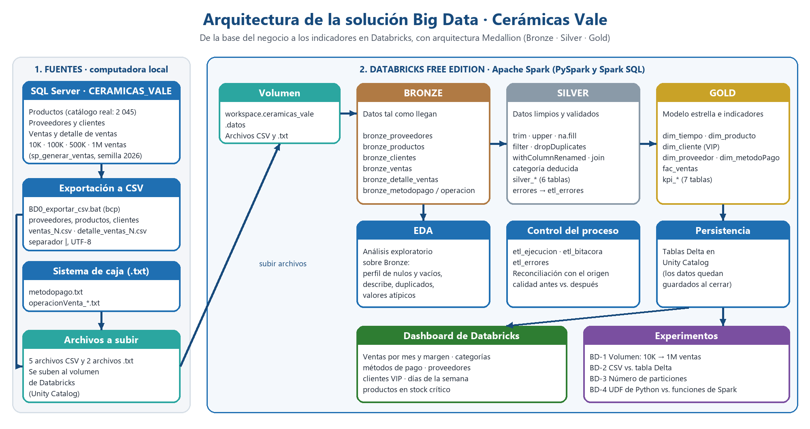
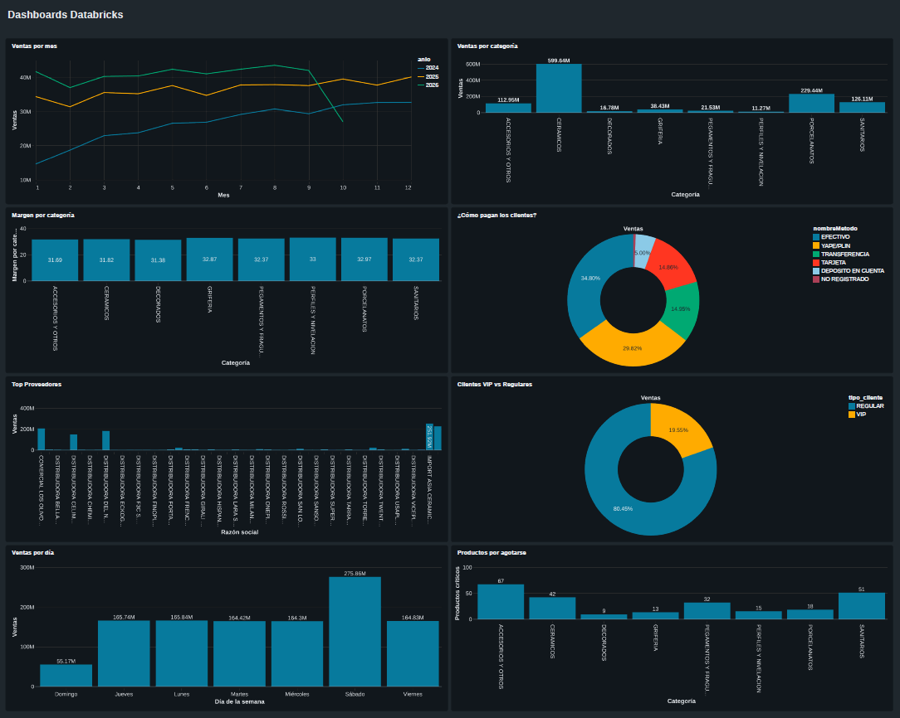

# Cerámicas Vale: base de datos, ETL y dashboard

Proyecto final del curso **Base de Datos Avanzadas y Big Data** (UPN, 2026-2).
Los scripts crean todo desde cero, así que no hace falta tener ninguna otra base de datos.
Herramientas: SQL Server (SSMS 22) y Power BI Desktop para la solución BI; Databricks Free Edition (Apache Spark 4.2.0) para la solución Big Data.

---

## Contenido

- [Estructura del repositorio](#estructura-del-repositorio)
- [Cómo ejecutarlo](#cómo-ejecutarlo)
- [De dónde salen los datos](#de-dónde-salen-los-datos)
- [Modelo estrella](#modelo-estrella)
- [El ETL](#el-etl-03_etl_cargasql)
- [Dashboard](#dashboard-4-páginas)
- [Pruebas con distintos volúmenes](#pruebas-con-distintos-volúmenes)
- [Experimentos de la solución BI](#experimentos-de-la-solución-bi)
- [Solución Big Data (Databricks)](#solución-big-data-databricks)
- [Experimentos de la solución Big Data](#experimentos-de-la-solución-big-data)
- [Automatización del ETL](#automatización-del-etl)
- [Documento de replicación](#documento-de-replicación)
- [Dónde está cada entregable](#dónde-está-cada-entregable)
- [Equipo](#equipo)

---

## Estructura del repositorio

```
BIG-DATA/
├── SQL SCRIPTS/
│   ├── 01_base_transaccional.sql
│   ├── 02_crear_entorno_etl.sql
│   └── 03_ETL_CARGA.sql
├── TXT/ceramicas_vale/
│   ├── metodopago.txt
│   ├── operacionVenta.txt          (100K ventas)
│   ├── operacionVenta_10000.txt    (10K ventas)
│   ├── operacionVenta_500000.txt   (500K ventas)
│   └── operacionVenta_1000000.txt  (1M ventas)
├── DATOS/
│   ├── Reporte_Items_2026-10-19 23_21_47.xlsx
│   └── catalogo_productos_2026-10-19.csv
├── VISUAL/
│   ├── POWER BI/   (modelo, dashboards y archivo .pbix)
│   └── SQL/        (diagrama del modelo estrella)
├── EVIDENCIAS/     (capturas de las pruebas de 10K, 100K y 500K)
│   ├── EXPERIMENTOS_BI/         (capturas de los 4 experimentos de BI)
│   └── EXPERIMENTOS_BIG_DATA/   (capturas y gráficos de los 4 experimentos de Big Data)
├── EXPERIMENTOS/BI/      (scripts, guía y archivos .pbix de los experimentos de BI)
├── BIG_DATA/
│   ├── BD0_exportar_csv.bat          (exporta las tablas de SQL Server a CSV)
│   ├── arquitectura_big_data.png     (diagrama de la solución Big Data)
│   └── notebooks/                    (notebook principal Medallion y notebooks BD-2 a BD-4)
├── AUTOMATIZACION/       (ejecutar_etl.bat y guía para programar el ETL)
├── DOCUMENTO_DE_REPLICACION (.pdf/.docx/.md) + img_replicacion/  (paso a paso de BI, Big Data y experimentos)
├── 2026-2_ISC-Informe_Proyecto_Final_BASAV (.docx/.pdf)          (informe del proyecto)
└── Sistema transaccional y analítico con BI y Big Data – Cerámicas Vale.pdf  (presentación)
```

| Archivo | Qué hace |
|---|---|
| `SQL SCRIPTS/01_base_transaccional.sql` | Crea la base `CERAMICAS_VALE` con sus tablas, el catálogo real (2,045 productos), los proveedores, los clientes y 100,000 ventas. |
| `SQL SCRIPTS/02_crear_entorno_etl.sql` | Crea el Data Mart `CeramicasVale_DM` (modelo estrella, staging, bitácora y tabla de errores). |
| `SQL SCRIPTS/03_ETL_CARGA.sql` | El ETL paso a paso. Al final valida la calidad y calcula algunos KPIs. |
| `TXT/ceramicas_vale/` | Los archivos planos del sistema de caja que lee el ETL. |
| `DATOS/Reporte_Items_2026-10-19 23_21_47.xlsx` | El catálogo original que exportamos del sistema de la empresa (corte del 19/10/2026). |
| `DATOS/catalogo_productos_2026-10-19.csv` | El mismo catálogo pasado a CSV. De aquí sale la parte 2 del script 01. |
| `VISUAL/POWER BI/Ceramicas Vale.pbix` | El dashboard en Power BI. |
| `BIG_DATA/` | La solución Big Data: exportación a CSV, notebooks de Databricks y diagrama (ver [Solución Big Data](#solución-big-data-databricks)). |

---

## Cómo ejecutarlo

**1. Copiar los archivos planos.** Copiar la carpeta `TXT\ceramicas_vale` dentro de `C:\txt\`. Tienen que quedar estos dos archivos:

```
C:\txt\ceramicas_vale\metodopago.txt
C:\txt\ceramicas_vale\operacionVenta.txt
```

**2. Ejecutar los scripts.** Abrir SSMS y ejecutar cada script con `F5`, en este orden:

1. `01_base_transaccional.sql`
2. `02_crear_entorno_etl.sql`
3. `03_ETL_CARGA.sql`

**3. Abrir el dashboard.** Abrir `VISUAL/POWER BI/Ceramicas Vale.pbix` en Power BI Desktop y actualizar los datos.

> **Para probar con otros volúmenes** (10K, 500K o 1M ventas) se usan los scripts de `EXPERIMENTOS/BI`; el paso a paso está en la Parte II del [documento de replicación](DOCUMENTO_DE_REPLICACION.pdf).

---

## De dónde salen los datos

| Fuente | Tipo | Origen |
|---|---|---|
| `PRODUCTOS` | Tabla OLTP | Catálogo real de la empresa: Excel del 19/10/2026, pasado a CSV y cargado con `INSERT`. Son 2,045 productos (76 nuevos respecto al de septiembre y 3 deshabilitados). |
| `PROVEEDORES`, `CLIENTES` | Tablas OLTP | Inventados por nosotros, no hay datos personales reales. |
| `VENTAS`, `DETALLE_VENTAS` | Tablas OLTP | 100,000 ventas generadas con `sp_generar_ventas` (semilla 2026), así que siempre salen los mismos datos. |
| `metodopago.txt` | Archivo plano | Catálogo de métodos de pago del sistema de caja. |
| `operacionVenta.txt` | Archivo plano | Exportación de caja con el formato `comprobante\|metodoPago`. |

---

## Modelo estrella

| Tabla | Contenido |
|---|---|
| `fac_ventas` | Cantidad (cajas o unidades), monto vendido, metraje vendido (m²), costo de inventario y descuento. |
| `dim_producto` | Descripción, categoría, marca, unidad, m² por caja, stock y estado del stock. |
| `dim_cliente` | Documento, nombre, distrito y tipo de cliente (REGULAR o VIP). |
| `dim_tiempo` | Fecha, año, trimestre, mes, semana y día. |
| `dim_metodoPago` | Efectivo, Yape/Plin, tarjeta, transferencia, depósito y "no registrado". |
| `dim_proveedor` | RUC, razón social y ciudad. |


---

## El ETL (`03_ETL_CARGA.sql`)

| Paso | Qué hace | Limpieza que aplica |
|:---:|---|---|
| 1 | Borra hechos, dimensiones y staging (`DELETE` y `RESEED`). | — |
| 2 | Carga `dim_proveedor`. | Pasa a mayúsculas. Si la ciudad viene vacía, pone NO ESPECIFICADO. |
| 3 | Carga `dim_producto`. | Mayúsculas y espacios dobles fuera. Deduce la categoría desde la descripción (venía vacía en 1,957 de los 2,045 productos), descarta los precios de prueba (S/ 1 o menos) y marca el stock crítico. |
| 4 | Carga `dim_cliente`. | Corrige nombres mal escritos, pone NO ESPECIFICADO si falta el distrito y marca como VIP al 10 % que más compra. |
| 5 | Carga `dim_tiempo`. | Genera el calendario con un `WHILE`, entre la primera y la última venta. |
| 6 | Carga `dim_metodoPago`. | `BULK INSERT` del txt, limpia espacios y minúsculas y quita duplicados. |
| 7 | Carga `stg_operacion`. | `BULK INSERT` del txt. Detecta comprobantes duplicados y métodos que no existen. |
| 8 | Carga `fac_ventas`. | Deja fuera los anulados y las líneas con precio o cantidad menor o igual a 0. Convierte los m² a cajas. |

Los tiempos y las filas de cada paso quedan en `etl_bitacora`. Lo que se descarta, con su motivo, queda en `etl_errores`.

---

## Dashboard (4 páginas)

| Página | Qué muestra |
|---|---|
| **Resumen Ejecutivo** | Ventas, crecimiento contra el año anterior, margen contra la meta del 35 %, métodos de pago, categorías y proveedores. |
| **Almacén y Rotación** | Capital inmovilizado, clasificación ABC, mapa de rotación y qué conviene liquidar o reponer. |
| **Clientes y Demanda** | Días en que más se vende, distritos, clientes VIP y estacionalidad. |
| **ETL** | Ejecuciones, duración por paso y registros observados según el problema de calidad. |


---

## Pruebas con distintos volúmenes

| Escenario | Ventas | Líneas de detalle | Filas en `fac_ventas` | Tiempo total del ETL | Reconciliación |
|:---:|---:|---:|---:|---:|:---:|
| E1 | 10,000 | 24,941 | 24,387 | 1.40 s | ✅ OK |
| E2 | 100,000 | 250,203 | 242,023 | 3.14 s | ✅ OK |
| E3 | 500,000 | 1,249,267 | 1,183,472 | 11.45 s | ✅ OK |

Las capturas de cada escenario (iteraciones, uso de disco, reconciliación, descartes y CPU) están en `EVIDENCIAS/10K`, `EVIDENCIAS/100K` y `EVIDENCIAS/500K`.

---

## Experimentos de la solución BI

Cada integrante hizo un experimento distinto en su propia computadora. Los scripts y la guía paso a paso
(`GUIA_EXPERIMENTOS_BI.pdf`) están en [`EXPERIMENTOS/BI`](EXPERIMENTOS/BI); las capturas, en
[`EVIDENCIAS/EXPERIMENTOS_BI`](EVIDENCIAS/EXPERIMENTOS_BI). El detalle de cada uno está en la sección 6.7 del informe.

| Código | Experimento | Integrante | Resultado principal |
|---|---|---|---|
| BI-1 | Volumen progresivo (10K → 1M ventas) | Diego Rojas | Con 1 millón de ventas el ETL tarda 41.3 s en SQL Server Express: cumple la meta de menos de 60 s |
| BI-2 | Cursor vs. consulta por conjuntos | Jimi Huasupoma | El cursor es 92 veces más lento y usa 40 veces más CPU |
| BI-3 | Un COMMIT por fila vs. un solo COMMIT | Bruno Elescano | Una sola transacción es unas 19 veces más rápida |
| BI-4 | Power BI: Importar vs. DirectQuery | Sebastián Huarancca | Importar responde 1.7 veces más rápido; DirectQuery muestra los cambios al instante; el .pbix con Importar pesa 139 veces más |

Todos los scripts se abren en SSMS y se ejecutan con **F5**. BI-2 y BI-3 trabajan en tablas de prueba que se borran al final.

---

## Solución Big Data (Databricks)

La solución Big Data procesa en **Databricks Free Edition** (cómputo serverless) con **Apache Spark (PySpark)** los mismos datos de la solución BI (semilla 2026), con la **arquitectura Medallion**: cada capa se guarda como tabla **Delta** en Unity Catalog (`workspace.ceramicas_vale`). Como usa los mismos datos, sus resultados se comparan fila por fila con el Data Mart de SQL Server.



```
SQL Server (CERAMICAS_VALE) ──BD0_exportar_csv.bat──► 11 CSV ─┐
TXT/ceramicas_vale (archivos de caja) ───────────────► 5 TXT ─┤
                                                              ▼
                         Volumen workspace.ceramicas_vale.datos (16 archivos)
                                                              ▼
   BRONZE  7 tablas bronze_*  ·  datos tal como llegan (4.5 millones de filas con 1M ventas)
                                                              ▼
   EDA     perfil de nulos, vacíos, distintos, describe(), duplicados y atípicos
                                                              ▼
   SILVER  6 tablas silver_*  ·  limpieza con DataFrames (mismas reglas que el ETL de SQL Server)
                                                              ▼
   GOLD    5 dimensiones + fac_ventas + 7 tablas kpi_*  ·  reconciliación con el origen
                                                              ▼
                              Dashboard de Databricks (8 gráficos)
```

| Archivo | Qué hace |
|---|---|
| `BIG_DATA/BD0_exportar_csv.bat` | Genera los 4 volúmenes de ventas en SQL Server y exporta las tablas a CSV con `bcp` (≈ 3 min). Al final deja la base con 100 000 ventas. |
| `BIG_DATA/notebooks/01_ETL_Medallion_CeramicasVale.py` | Notebook principal: Bronze, EDA, Silver, Gold, `kpi_*`, reconciliación, calidad antes/después, indicadores y experimento BD-1. |
| `BIG_DATA/notebooks/BD2_CSV_vs_Delta.py` | Experimento BD-2. |
| `BIG_DATA/notebooks/BD3_Particiones.py` | Experimento BD-3. |
| `BIG_DATA/notebooks/BD4_UDF_vs_Funciones_Spark.py` | Experimento BD-4. |
| `BIG_DATA/arquitectura_big_data.png` | Diagrama de arquitectura. |

### Cómo ejecutarlo (resumen)

1. Con la base `CERAMICAS_VALE` creada (script 01), doble clic en `BIG_DATA/BD0_exportar_csv.bat`. Deja 11 CSV en `C:\csv\ceramicas_vale`.
2. En Databricks: **Catalog → workspace → Create → Schema** `ceramicas_vale`, y dentro **Create → Volume** `datos`.
3. Subir al volumen los 11 CSV y los 5 TXT de `TXT/ceramicas_vale` (16 archivos).
4. **Workspace → Import** del notebook `01_ETL_Medallion_CeramicasVale.py`, elegir el volumen en el cuadro **1. Volumen de ventas** y pulsar **Run all** (≈ 2 min).
5. Está bien si la ejecución termina **EXITOSO**, los 9 pasos en EXITOSO y la reconciliación en **OK** (diferencia S/ 0.00).

El paso a paso con capturas, para alguien que nunca usó Databricks, está en la **Parte III** del [documento de replicación](DOCUMENTO_DE_REPLICACION.pdf).

### Qué hace el notebook

| Capa | SQL Server (`03_ETL_CARGA.sql`) | Databricks (PySpark) |
|---|---|---|
| Bronze | `BULK INSERT` y tablas de origen | `spark.read.csv` con esquema explícito → `saveAsTable` de 7 tablas `bronze_*` |
| EDA | — | Nulos, vacíos y distintos por columna, `describe()`, duplicados, atípicos y ventas por día y mes |
| Silver | `UPPER`, `LTRIM/RTRIM`, `ISNULL`, `CASE…LIKE`, `TOP 10 PERCENT` | `upper`, `trim`, `na.fill`, `when` + `contains`, `dropDuplicates`, `join` y ventanas |
| Gold | Calendario con `WHILE`; `INSERT…SELECT…GROUP BY` | `sequence` + `explode`; `join` + `groupBy` + `agg` → `fac_ventas` y 7 tablas `kpi_*` |
| Control | `etl_bitacora`, `etl_errores`, `etl_ejecucion` y reconciliación | Las mismas tablas de control, como Delta, y la misma reconciliación |

**Calidad de datos (igual que en SQL Server):** 1 957 productos sin categoría → 0; 290 descripciones con minúsculas o espacios → 0; 23 nombres de clientes con errores → 0; 17 precios de prueba → 0; 17 clientes sin distrito → NO ESPECIFICADO; ningún nulo en `fac_ventas`.



---

## Experimentos de la solución Big Data

Cada integrante hizo un experimento en su propia cuenta de Databricks Free Edition, con 1 000 000 de ventas. Las capturas están en [`EVIDENCIAS/EXPERIMENTOS_BIG_DATA`](EVIDENCIAS/EXPERIMENTOS_BIG_DATA) y el detalle, en la sección 6.8 del informe.

| Código | Experimento | Integrante | Resultado principal |
|---|---|---|---|
| BD-1 | Volumen progresivo (10K → 1M ventas) | Bruno Elescano | El volumen crece 100 veces y el tiempo solo 1.45 veces (90.9 s → 131.8 s); con 1M cumple el límite de 5 min y la reconciliación da OK |
| BD-2 | Leer CSV vs. leer tabla Delta | Jimi Huasupoma | Delta es 1.5 veces más rápido y ocupa 5.9 veces menos (23.7 MB contra 139.2 MB) |
| BD-3 | Número de particiones (1 a 200) | Diego Rojas | 4 particiones es lo más rápido (1.01 s); 200, el valor por defecto, lo más lento (1.64 s) |
| BD-4 | Función propia de Python (UDF) vs. funciones de Spark | Sebastián Huarancca | Las funciones de Spark son 15 veces más rápidas (1.14 s contra 17.09 s) |

### BD-1 · Volumen progresivo

Cuatro ejecuciones por volumen del notebook principal, el 27/11/2026:

| Ventas | Filas en `fac_ventas` | Promedio | Mín. – máx. | Filas por segundo | Reconciliación |
|---:|---:|---:|---:|---:|:---:|
| 10 000 | 24 387 | 90.90 s | 45.73 – 108.09 s | 268 | ✅ OK |
| 100 000 | 242 023 | 109.30 s | 105.16 – 115.82 s | 2 214 | ✅ OK |
| 500 000 | 1 183 472 | 115.28 s | 114.24 – 116.87 s | 10 266 | ✅ OK |
| 1 000 000 | 2 327 810 | 131.80 s | 117.88 – 166.10 s | 17 662 | ✅ OK (S/ 0.00) |

**Comparación con BI-1** (SQL Server Express, misma semilla y mismos volúmenes):

| Ventas | BI-1 · SQL Server | BD-1 · Databricks |
|---:|---:|---:|
| 10 000 | 3.45 s | 90.90 s |
| 1 000 000 | 41.27 s | 131.80 s |
| Crecimiento | 12 veces | 1.45 veces |

- **Mismo resultado en las dos soluciones:** las mismas filas de hechos y el mismo total vendido.
- **El tiempo de Databricks casi no depende del volumen:** gran parte es un costo fijo (arranque del cómputo serverless, escritura de unas 30 tablas Delta y las celdas de EDA y calidad).
- **Con estos volúmenes SQL Server es más rápido, pero Databricks escala mejor:** su ventaja aparece cuando los datos crecen. Los dos entornos son distintos (una PC con SQL Server Express y el cómputo gratuito compartido de Databricks).

---

## Automatización del ETL

El script 03 puede correr solo cada noche con el Programador de tareas de Windows (`AUTOMATIZACION/ejecutar_etl.bat`)
o con el Agente SQL Server. Los pasos están en [`AUTOMATIZACION/AUTOMATIZACION_ETL.md`](AUTOMATIZACION/AUTOMATIZACION_ETL.md).
Si un paso falla, la ejecución queda como **ERROR** en `etl_ejecucion`.

---

## Documento de replicación

[`DOCUMENTO_DE_REPLICACION.pdf`](DOCUMENTO_DE_REPLICACION.pdf) (también en [Markdown](DOCUMENTO_DE_REPLICACION.md) y Word) explica, paso a paso y con capturas, cómo replicar todo en otra computadora, pensado para alguien que no conoce las herramientas:

| Parte | Qué se replica |
|---|---|
| I | Solución BI: SQL Server, ETL y dashboard en Power BI |
| II | Experimentos BI-1 a BI-4 |
| III | Solución Big Data en Databricks: exportar, subir, ejecutar el notebook y armar el dashboard |
| IV | Experimentos BD-1 a BD-4 |

---

## Dónde está cada entregable

| Entregable | Dónde |
|---|---|
| Solución BI documentada (modelo dimensional, Data Mart, ETL, dashboards e indicadores) | `SQL SCRIPTS/`, `VISUAL/`, `EVIDENCIAS/` e informe (secciones 3.4, 5.2 y 6.1 a 6.7) |
| Solución Big Data documentada (arquitectura, notebooks, DataFrames, EDA, limpieza, procesamiento, persistencia y visualizaciones) | `BIG_DATA/`, `EVIDENCIAS/EXPERIMENTOS_BIG_DATA/` e informe (secciones 3.5, 5.3 y 6.8) |
| Repositorio documentado | Este README |
| Documentación de replicación | `DOCUMENTO_DE_REPLICACION` (.pdf, .docx y .md) |
| Informe del proyecto | `2026-2_ISC-Informe_Proyecto_Final_BASAV.docx` y `.pdf` |

## Equipo

| Integrante | Experimentos |
|---|---|
| Elescano Medina, Bruno Martin Kalen | BI-3 y BD-1 (notebook principal y dashboard de Databricks) |
| Huarancca Cachique, Sebastian Victor | BI-4 y BD-4 |
| Huasupoma Rodas, Jimi Roger | BI-2 y BD-2 |
| Rojas Condorchoa, Diego Javier | BI-1 y BD-3 |
